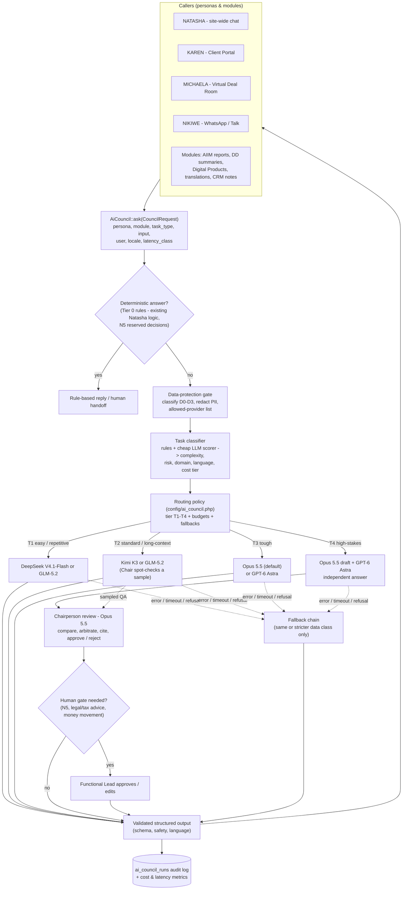

# TBCA Integrations & AI Architecture Plan

**Status:** Planning draft for client review, updated 13 October 2026. Sections 8 (VOVE ID), 11 (translation) and 18 (Zoho One) describe code that is now built; the rest is still a plan.
**Prepared:** 6 October 2026, in response to the client review of 5 October 2026.
**Scope:** Third-party integrations and the "AI Council" (the AI that drives the WebApp) for The Business Clinic.Africa (TBCA). The app is Laravel 13 + Inertia + React on Laravel Cloud, with Postgres.

> **How to read this document.** Every service below was checked against its own website or documentation, or against reputable third-party coverage, in early October 2026. Links are inline. Where a vendor does not publish something (pricing, APIs, hosting location), the document says so instead of guessing. Prices are indicative list prices in USD, EUR or GBP as published. Confirm them in writing before signing anything. **Client documents in Google Drive take precedence over this plan wherever they conflict.** That includes the payment-gateway document, the Zoho "18 apps" list, Batches 4A–4D and the Back-End Structure folder.

---

## Contents

1. [Platform context and ground rules](#0-platform-context-and-ground-rules)
2. [WhatsApp: WhatChimp vs Lalexi (NIKIWE)](#1-whatsapp-whatchimp-vs-lalexi--nikiwe)
3. [NOTP instead of OTPs (JungleWorks Hippo NOTP)](#2-notp-instead-of-otps--jungleworks-hippo-notp)
4. [Krisp: translation and noise cancellation](#3-krisp--voice-translation--noise-cancellation)
5. [Voiso VOIP call centre and Client Portal link](#4-voiso-voip-call-centre--client-portal-link)
6. [Zoho One: the must-have apps](#5-zoho-one--the-must-have-apps)
7. [Zeely: platform marketing](#6-zeely--platform-marketing)
8. [Gio AI Portrait Photo Editor: persona avatars](#7-gio-ai-portrait-photo-editor--persona-avatars)
9. [VOVE ID: KYC for Due Diligence](#8-vove-id--kyckybaml-for-due-diligence)
10. [AI Systems Vault: calculators and templates](#9-ai-systems-vault--calculators--templates)
11. [Osiris AI for AIIM](#10-osiris-ai-for-aiim)
12. [Real-time translation in 7 languages](#11-real-time-translation-7-languages)
13. [Live FX for 5 currencies](#12-live-fx-5-currencies)
14. [Payment gateways for the whole of Africa](#13-payment-gateways-for-the-whole-of-africa)
15. [The AI Council: the "Brain of the WebApp"](#14-the-ai-council--brain-of-the-webapp)
16. [Skills, Connectors and Plugins for "200%"](#15-skills-connectors-and-plugins-for-200)
17. [Prioritised roadmap](#16-prioritised-roadmap)
18. [What the client must provide (checklist)](#17-client-checklist)
19. [Zoho One integration](#18-zoho-one-integration)
20. [Cover images for all 7,008 Sprints](#19-cover-images-for-all-7008-sprints)

---

## 0. Platform context and ground rules

### What exists today (relevant to this plan)

| Area | Current state in the codebase |
|---|---|
| AI assistant | `App\Support\Portal\Natasha::answer()` is a **deterministic, rule-based interim reply function**. It matches keywords and composes answers from data the signed-in client is allowed to see, using authority levels N1/N2. It refuses "reserved decisions" (N5) and hands them off to a human. It has an escalation ladder (L0–L4) and a kill switch. The AI Council replaces the *reply generation* but should keep this authority model. |
| Personas | NATASHA (site-wide), KAREN (Client Portal), MICHAELA (Virtual Deal Room), NIKIWE (WhatsApp/Talk secure chat). |
| Languages | `config/tbca.php` defines the 7 languages with `dir` (Arabic is `rtl`). Only English is live; the rest are marked `coming_soon`. |
| Currencies | Prices are stored and charged in **ZAR**. Other currencies are display-only conversions via `App\Support\Platform\Fx`. That uses the free daily feed `open.er-api.com/v6/latest/ZAR`, caches it for 24 hours and falls back to configured rates. |
| Payments | Simulated. No money moves. |
| Messaging | Emails and WhatsApp messages are not yet sent through real providers. |
| Queue | Database queue driver. |

### Ground rules every integration follows

1. **One brain.** Every AI reply goes through one internal `AiCouncil` service (section 14), on every channel: web chat, WhatsApp, Client Portal, VDR and call-centre summaries. A vendor's built-in AI agent, such as WhatChimp's or Lalexi's, is **not** used as a second brain. Otherwise TBCA would end up with several AIs giving inconsistent answers, each with its own data-protection exposure.
2. **The app owns the business records.** Orders, sprints, deal rooms and client entitlements live in TBCA's Postgres. Zoho is the system of record only for what it does best: the accounting ledger (Books), CRM pipeline/contacts, helpdesk tickets (Desk) and HR. Each object has exactly one owner (see the table in section 5).
3. **All inbound webhooks are verified.** Each one has its signature checked, is stored raw, and is processed on a queue with idempotency keys. This is how "never lose a lead" is enforced technically.
4. **POPIA first.** TBCA is a South African responsible party. Sending personal information to a provider outside South Africa is a cross-border transfer under **POPIA section 72**. It needs an adequate-protection basis, a binding agreement (a DPA with appropriate clauses) or data-subject consent ([CMS overview](https://cms.law/en/zaf/legal-updates/Managing-cross-border-data-transfers), [ACC paper](https://www.acc.com/sites/default/files/resources/upload/cross-border-data-transfers-under-the-protection-of-personal-information-act-4-of-2013.pdf)). Special personal information and children's information (for example, biometrics from KYC selfies) carry extra conditions, including possible prior authorisation by the Information Regulator under s57. **Note:** Laravel Cloud's regions are in the US, Canada, EU and Asia-Pacific, with **no African region** listed ([Laravel Cloud changelog/docs](https://cloud.laravel.com/docs/changelog)). The app's own hosting is therefore already a cross-border transfer and should be covered in TBCA's privacy notice and DPAs. **A South African privacy lawyer should sign off the data-classification policy in section 14.6.**
5. **Effort scale** (one experienced Laravel/React developer): **S** = up to 1 week, **M** = 2–4 weeks, **L** = 5+ weeks. Estimates assume accounts and keys are ready (see section 17).

---

## 1. WhatsApp: WhatChimp vs Lalexi (NIKIWE)

### Purpose in TBCA

- Clicking **WhatsApp/Talk** on any page opens an **FNB-style secure chat** drawer. NIKIWE answers 24/7 and hands over to a human **Functional Lead** according to the topic.
- The main number is **+27 60 801 1365**, plus **10 virtual numbers** for consultants and Functional Leads.
- **Never lose a lead:** every conversation is captured, attributed and synced to the CRM.

### What each vendor offers (verified)

| | **WhatChimp** ([site](https://whatchimp.com/), [pricing](https://whatchimp.com/pricing/)) | **Lalexi** ([site](https://lalexi.com/)) |
|---|---|---|
| WhatsApp access method | **Official WhatsApp Business Platform (Cloud API).** It is a verified Meta Business Partner and states a "0% markup" on Meta conversation fees. | Positions itself as "WhatsApp and Telegram for client-facing teams". Third-party descriptions say it **mirrors reps' personal WhatsApp/Telegram accounts** into one inbox, with "warmup" and "send limits" for outbound ([search summary of lalexi.com](https://lalexi.com/)). The homepage does **not** say whether it uses the official API. **Unclear and needs confirming with Lalexi.** |
| AI bot + human handoff | Yes: AI agent, chatbot flows, shared inbox, auto-routing and intent detection (Pro). | Yes: AI agent trained on operators' past chats, with "I'll pass this to a colleague" handoff. |
| Multiple numbers | **Enterprise plan only** ("multiple WhatsApp numbers", unlimited team members). | Not stated publicly. Personal-account mirroring implies one account per rep. |
| API / webhooks | **API access and webhooks on all plans**, plus Zapier, Make, n8n and Pabbly connectors. **No native Zoho connector listed.** | No public API documentation found. |
| Pricing | Basic $24/mo (annual), Pro $60/mo (annual), Enterprise custom. Meta per-message fees are on top. | Not published ("short demo, no credit card"). |
| Africa / data hosting | Not stated. | Not stated. |

**Meta's pricing changed on 1 October 2026.** In South Africa, business-initiated **marketing** messages cost about **$0.0379**. **Utility** and **authentication** messages cost about **$0.0076** (authentication rises to $0.0200 when international). Service (customer-initiated) replies moved to per-message billing, and the first 1,000 service messages per number per month are reported as free. VAT of 15% applies ([MyBroadband](https://mybroadband.co.za/news/business/662921-big-change-coming-for-whatsapp-business-in-south-africa-where-every-reply-will-cost-12-cents.html), [Briefly](https://briefly.co.za/people/250520-meta-charge-whatsapp-business-api-users-message-1-october-2026/), [ChatMaxima SA rates](https://chatmaxima.com/whatsapp-api-pricing/south-africa/)). Confirm the current rate card with the chosen BSP.

### Recommendation: **WhatChimp (Enterprise)**, with TBCA's own brain behind it

- **Use WhatChimp.** It is on the official API, so numbers are not at risk of bans for automation. It has documented webhooks and an API, and published pricing.
- **Do not use Lalexi for the bot or the main number.** If it automates personal WhatsApp accounts, that conflicts with WhatsApp's terms for automated or bulk messaging and risks the main number being banned. That is the opposite of "never lose a lead". Lalexi could still be considered later *only* as a staff-device chat-retention tool, once it confirms its access method in writing.
- **Rethink "10 virtual numbers".** Two designs are possible:
  - **A. One number, ten routed inboxes (recommended to start).** Everything comes in on +27 60 801 1365. NIKIWE classifies the topic, and the conversation is assigned to the right Functional Lead's queue in the shared inbox. Customers see one consistent TBCA number, leads cannot be stranded on a consultant's line, and it is cheaper.
  - **B. Ten extra WhatsApp numbers** (Enterprise plan). Each number must be registered under TBCA's verified Meta Business account and able to receive a verification SMS or call. Meta applies per-business number limits that rise after business verification; confirm the limit with WhatChimp/Meta. Use this only if consultants need publicly advertised direct lines. Virtual DIDs can be sourced from Voiso (section 4) or a local carrier.
- **The main number today:** if +27 60 801 1365 is currently on the WhatsApp Business *app*, ask the BSP about migrating it to the API, or about Meta's app-plus-API "coexistence" option. That option was not verified in this pass. Moving the number may affect the existing chat history on the phone.

### Where it plugs in

| Screen / module | Integration |
|---|---|
| Header/footer **WhatsApp/Talk** button (all pages), Home | Opens the in-app **Secure Chat** drawer, styled like FNB. It runs on TBCA's own web chat (Laravel Reverb websockets) **and** offers "Continue on WhatsApp" (a `wa.me` deep link carrying a reference token). |
| Client Portal → Support / Notices | WhatsApp threads appear on the client's timeline, and handoffs create Desk/Portal tickets. |
| Admin / staff consoles | A Functional Lead inbox view, or a deep link into the WhatChimp inbox. |

### Data flow

```
Customer WhatsApp → Meta Cloud API → WhatChimp → (webhook) → TBCA /webhooks/whatchimp
  → store raw event → queue: ResolveContact (match phone → User / Lead) → AiCouncil(persona=NIKIWE)
  → reply via WhatChimp API (within the 24h service window)
  → if handoff: assign WhatChimp conversation to Functional Lead + create Zoho CRM Lead/Deal + Desk ticket
  → nightly reconciliation job: pull WhatChimp contacts/conversations, diff against CRM ("never lose a lead")
```

### Security / POPIA

- The WhatsApp message content passes through Meta and WhatChimp. Obtain WhatChimp's DPA and its hosting location, which is not published.
- Take opt-in consent for marketing templates. Honour STOP/opt-out, and keep marketing separate from utility traffic.
- Don't send KYC documents or deal-room content over WhatsApp. Reply with a secure portal link instead.

| Effort | Prerequisites from client |
|---|---|
| **M** (web chat + WhatsApp + handoff + CRM sync). Add **S** for option B numbers. | Meta Business Manager with **business verification**, a WhatChimp Enterprise account, the main number's current status (app or API), the list of Functional Leads with topics, hours and emails ("Human Capital Build" doc), and approved message templates. |

---

## 2. NOTP instead of OTPs (JungleWorks Hippo NOTP)

### Purpose

Replace SMS one-time passwords at sign-up and login with a **WhatsApp-based passwordless** flow.

### What NOTP is (verified)

- JungleWorks' NOTP lets customers "log in or sign up via WhatsApp" with no password or OTP. JungleWorks claims 40–60% SMS savings and a 25% sign-up uplift. It works on iOS, Android and web ([NOTP page](https://jungleworks.com/hippo/notp/)).
- It is documented as a **feature of JungleWorks' own products** (Hippo, Yelo), switched on by an admin toggle. "Every Admin gets 50 free NOTP hits" ([JungleWorks "What's New"](https://help.jungleworks.com/yelo/whats-new/)). The user is redirected to WhatsApp, where they receive a sign-in link.
- **Not found:** a public stand-alone API or SDK for third-party apps such as a Laravel site, the pricing beyond the free hits, and the country coverage. Hippo itself is listed from about $17/month, usage-based ([GetApp](https://www.getapp.com/customer-service-support-software/a/hippo/)).

### Recommendation

1. **Ask JungleWorks in writing** whether NOTP can be used stand-alone through an API by a non-JungleWorks app, and at what price per verification. If it can't, it would tie TBCA's login to the Hippo platform.
2. **Preferred approach: build the same "reverse-OTP" pattern on TBCA's own WhatsApp number (section 1), and add passkeys.**
   - **WhatsApp login link:** the user taps "Continue with WhatsApp", which opens `wa.me/27608011365?text=LOGIN-<nonce>`. TBCA's inbound webhook confirms that the sender's number owns the account, then the browser session is logged in through a websocket or polling, or TBCA replies with a one-time magic link. Because the user starts the conversation, it is a cheap service message. Meta's **authentication templates** (copy-code, one-tap, zero-tap) are the fallback; iOS 26 now offers keyboard autofill for them ([Meta docs](https://developers.facebook.com/documentation/business-messaging/whatsapp/templates/authentication-templates/authentication-templates)). The local SA authentication rate is about $0.0076 per message.
   - **Passkeys (WebAuthn)** for returning users and for high-risk areas such as the VDR, Due Diligence and payments. This is a genuine "no OTP" option that resists phishing.
   - **Email magic link** as a universal fallback, for users without WhatsApp.
3. **Security:** a phone number alone is vulnerable to SIM-swap attacks. Require a passkey, or step-up verification, before VDR access, payouts or bank-detail changes.

| Where | Effort | Prerequisites |
|---|---|---|
| Auth pages (Login, Register, `AuthShell`), Client Portal step-up, VDR entry | **M** for the own build (WhatsApp link + passkeys). Unknown for NOTP until JungleWorks answers. | The WhatsApp number on the API (section 1). If NOTP is chosen: a JungleWorks account, API documentation and a quote. |

---

## 3. Krisp: voice translation and noise cancellation

### Purpose

Make call-centre conversations work across languages, and remove background noise on consultant calls.

### What Krisp offers (verified)

- **Noise cancellation, voice isolation and accent conversion** for agents and customers.
- **Real-time voice (speech-to-speech) translation** for call centres. Krisp quotes 60+ languages on the pricing page, and its "AI Live Interpreter" claims 80+ languages ([pricing](https://krisp.ai/pricing/), [voice translation](https://krisp.ai/ai-voice-translation/), [Live Interpreter](https://krisp.ai/blog/krisp-launches-ai-live-interpreter-transforming-multilingual-support-worldwide/)). Krisp's language list includes **Afrikaans, Arabic (Standard and Egyptian) and Swahili** ([supported-languages article](https://help.krisp.ai/hc/en-us/articles/25670169242396-Supported-languages-for-Krisp-AI-Voice-Translation); the page blocked automated fetching, so this is from search indexing). Confirm all 7 TBCA languages, including Mandarin, Portuguese and French, during the trial.
- **Pricing:** Call Center **CC Core $15/agent/month** (annual) covers noise cancellation and after-call summaries. **CC Advanced** (custom price, 14-day trial) adds real-time voice translation, accent conversion, speech analytics and agent assist. The **Developer SDK and Voice Translation API** are application-only.
- **Transcripts/summaries** are offered in 16 languages. Swahili and Afrikaans are **not** on that transcript list.

### Important scoping note

Krisp is **voice-only**. The review asks for "Language Translations: (i) Platform and (ii) Call centre". Krisp covers **(ii)**. **(i)**, translating the platform's text, is section 11.

### Recommendation

- **Phase 2:** CC Core for all consultants (noise cancellation), installed on agent desktops alongside the Voiso softphone. Krisp generally sits between the microphone/speaker and any softphone. Whether Krisp has a specific Voiso integration was **not verified**.
- **Phase 3:** a CC Advanced trial for live translation, focused on French, Portuguese, Arabic and Swahili calls. Measure quality on real calls before committing.
- Optional later: the Krisp Voice Translation API for live translation inside the VDR's Zoom-style calls. That depends on SDK access approval.

| Where | Data flow | POPIA | Effort | Client provides |
|---|---|---|---|---|
| Call centre (Voiso agents), consultant meetings, VDR calls | Audio is processed by Krisp, on-device for noise cancellation and server-side for translation. Summaries can be pushed to the CRM. | Call audio is personal information. Get Krisp's DPA and the processing region for translation, and include call-recording/translation notices in the IVR greeting. | **S** (rollout/config). **M** if the SDK is embedded in the VDR. | Agent count, a Krisp account, a trial for CC Advanced, and target languages by queue. |

---

## 4. Voiso VOIP call centre (+ Client Portal link)

### What Voiso offers (verified)

- A cloud contact centre covering voice, SMS, web chat and WhatsApp. It has an AI predictive dialer, IVR/flow builder, speech analytics (transcription in 10 languages, sentiment, summaries) and **local caller ID in 120+ countries** ([voiso.com](https://voiso.com/)). It holds ISO 27001 and PCI DSS certification.
- **Native CRM integrations include Zoho.**
- **API** ([developers.voiso.com](https://developers.voiso.com/)): click-to-call (start/stop call), CDRs with speech analytics, call-recording events, agent-status webhooks, WhatsApp/SMS conversations, dialer campaigns, numbers/caller ID management, streaming to AWS SQS and recording replication to S3.
- **Pricing:** Core $24/user/month and Pro $52/user/month. **API access and omnichannel are on Pro.** There is about 30% off for a 1-year plan ([Voiso pricing](https://voiso.com/pricing-plans/), [Capterra ZA](https://www.capterra.co.za/software/203121/voiso)).
- **African number availability** (South Africa, Kenya, Nigeria and so on) is not itemised publicly. Get a country-by-country number list from Voiso.

### Where it plugs in

| Screen | Feature |
|---|---|
| **Client Portal** (KAREN), dashboard, Support, case pages | A **"Call me" / "Talk to my consultant"** button. TBCA calls the Voiso click-to-call API to ring the assigned consultant first, then the client. Past calls (date, agent, duration, recording link with permission, AI summary) show on the client's timeline. |
| Contact page, "Book a Discovery Call" | Click-to-call or callback request, routed to the right queue by service/topic. |
| Staff consoles | Screen-pop through Zoho CRM (native). The agent status of Functional Leads feeds the NIKIWE handoff, so the AI hands over only to someone available. |
| NIKIWE / AiCouncil | Call transcripts are summarised by the Council into a CRM note and a ticket. |

### Overlap warning

Voiso also does WhatsApp. **Pick one WhatsApp provider.** Use WhatChimp for WhatsApp and Voiso for voice, unless the client prefers a single vendor, in which case evaluate Voiso's WhatsApp module against WhatChimp's.

### Security / POPIA

Announce call recording. Replicate recordings to **TBCA's own S3 bucket** with a retention policy. Restrict recording access by role. PCI: never take card numbers on recorded calls; send a payment link instead.

| Effort | Client provides |
|---|---|
| **M** (click-to-call, webhooks, CDR timeline, CRM link) | A Voiso Pro account, the number of agents, required countries for local numbers, IVR scripts, queue/topic mapping to Functional Leads, and recording-retention policy. |

---

## 5. Zoho One: the must-have apps

### Facts (verified)

- **Pricing:** All-Employee pricing is **$37/employee/month** (annual) or $45 monthly. Flexible-user pricing is **$90/user/month** (annual) or $105 monthly. It includes 45–50+ apps ([Cloudwards](https://www.cloudwards.net/zoho-one-pricing/), [Zenatta](https://zenatta.com/zoho-pricing-guide-2025/)). The client's "40 apps" figure is likely an older or partial list.
- **Data centres:** Zoho has DCs in the US, EU, India, Australia, Japan, China, Canada, Saudi Arabia and the UAE. **There is no South African DC yet**; Zoho is reported to be planning one ([Bloomberg](https://www.bloomberg.com/news/articles/2026-02-25/billionaire-backed-zoho-plans-more-mideast-africa-data-centers), [billionaires.africa](https://www.billionaires.africa/2026/02/27/billionaire-backed-zoho-ramps-up-south-africa-push-with-plans-for-local-data-centers/), [DCD UAE](https://www.datacenterdynamics.com/en/news/zoho-corp-launches-two-data-center-regions-in-uae/)). **The DC is chosen at sign-up and is hard to change.** EU (GDPR-aligned, which helps the s72 "adequate protection" argument) or UAE are the realistic options today.
- **APIs:** every app has a REST API with OAuth 2.0. Zoho also runs an **official MCP platform** ([zoho.com/mcp](https://www.zoho.com/mcp/)), with pre-built servers for CRM, Books and Desk among others. That is useful for the AI Council (section 15).

**Superseded in part (13 October 2026).** The client's *TBCA Zoho One Implementation Guide* (11 October 2026) ranks 30 apps and sets the rollout order. Section 18 follows that guide and describes the integration layer now built. The table below is kept for the system-of-record reasoning.

### The client's list takes precedence

The client's Drive folder names the 18 required apps. The likely list below is justified against TBCA's modules and should be reconciled with it.

| # | Zoho app | Why TBCA needs it | Maps to TBCA module(s) | System of record? |
|---|---|---|---|---|
| 1 | **CRM** | Leads from web, WhatsApp, calls and marketing; pipeline for Sprints, Retainers, DD and Advisory deals. This is the core of "never lose a lead". | Contact, WhatsApp/Talk, Book a Discovery Call, Sprints checkout (abandoned baskets), Marketplace, Partner Services | **Yes, for leads/contacts/pipeline** |
| 2 | **Books** | VAT invoices, the 15% VAT and R250 platform fee, payments received, statements, multi-currency accounting. | Online Shop, Subscriptions, Retainers, Client Portal → Invoices & Statement | **Yes, for the accounting ledger** (the app keeps orders) |
| 3 | **Billing** (formerly Subscriptions) | Recurring billing, dunning and proration. | Subscriptions, Retainers | Optional. Use only if the app does not own subscription logic. **Decide one owner.** |
| 4 | **Desk** | Tickets, SLAs (matches Natasha's L0–L4 ladder), handoffs from NIKIWE/KAREN, multichannel. | Client Portal → Support Tickets, Notices | **Yes, for tickets**, if adopted. Otherwise keep the in-app tickets. |
| 5 | **Sign** | E-signature for engagement letters, NDAs, sprint SOWs, retainer agreements and VDR NDAs. | Sprints (Inputs Required/Process), Retainers, VDR, Partner Services | Signed PDFs are stored back in the app/WorkDrive |
| 6 | **WorkDrive** | Shared deliverable storage for consultants. | Client Portal → Documents/Deliverables (staff side) | No. The VDR stays in-app because it needs access control and audit. |
| 7 | **Bookings** | Discovery calls, consultant calendars and webinar slots. | Book a Discovery Call, Advisory, KP Thought Leadership/Webinars | Yes, for appointments |
| 8 | **Campaigns** | Email nurture, newsletters, POPIA-compliant opt-in lists. | Resources, Digital Products, Webinars | Yes, for marketing lists |
| 9 | **SalesIQ** | Visitor tracking and live-chat fallback. **Overlaps with in-app NATASHA/NIKIWE chat.** Use it only for visitor analytics/lead scoring, or skip it. | Site-wide | — |
| 10 | **Analytics** | Cross-app BI across CRM, Books, Desk and app data (via Postgres connector or API). | Admin dashboards, AIIM internal reporting | — |
| 11 | **Projects** | Sprint delivery tracking for consultants (tasks, milestones, timesheets). | Sprints, Retainers, Client Portal → Tasks & Milestones | **Decide one owner.** The app currently owns tasks; Projects would be staff-side, synced one way. |
| 12 | **People** | HR records for staff and Functional Leads; leave/attendance feeds availability for routing. | Human Capital Build, staff consoles | Yes, for HR |
| 13 | **Recruit** | Hiring consultants, partner experts and marketplace providers. | Careers (if any), Partner Services onboarding | Yes, for candidates |
| 14 | **Forms** | Quick external forms such as surveys and event registration. **Most intake forms should stay in-app** (Sprint inputs, DD questionnaires). | Webinars, surveys | — |
| 15 | **Flow** | No-code glue between Zoho apps and webhooks (WhatChimp → CRM, Voiso → Desk). Reduces custom code. | Integrations layer | — |
| 16 | **Creator** | Low-code internal apps, such as back-office checklists. **Avoid duplicating app features here.** | Staff-only tools | — |
| 17 | **Inventory** | Only if physical goods are sold. Otherwise not needed; digital products stay in-app. | Online Shop (physical items only) | — |
| 18 | **Cliq** | Internal chat; alerts to Functional Leads when NIKIWE hands over. | Handoff notifications | — |
| 19 | **Mail** | Hosting for `consult@thebusinessclinic.africa` and staff mailboxes (per the contacts document). | Contact, footer emails | Yes, for email |
| (+) | **Expense, Payroll (where available in SA), Social, Survey, Vault** | Candidates if the client's list includes them. | — | — |

Recommended core for phase 2: **CRM, Books, Desk, Sign, Bookings, Campaigns, Mail, Flow, Cliq.** Add Projects, People, Recruit, WorkDrive and Analytics in phase 3.

### Integration design

- A Laravel `Zoho` client using OAuth 2.0 (a server-based client with a refresh token stored encrypted) and **queued sync jobs**: `SyncContactToCrm`, `PushInvoiceToBooks`, `OpenDeskTicket` and so on.
- Zoho → TBCA updates arrive through Zoho **webhooks/workflow rules**, for example invoice paid, ticket resolved or deal stage changed.
- A mapping table (`external_refs`: model, id, system, external_id) gives idempotent sync and makes reconciliation possible.
- POPIA: Zoho is an operator, so sign Zoho's DPA, choose the DC deliberately and document it in the privacy notice.

| Effort | Client provides |
|---|---|
| **L** overall. CRM + Books **M**, Desk + Sign **M**, the rest **S** each. | The Zoho One subscription (pricing model), **DC choice**, the 18-app list from Drive, chart of accounts/VAT settings, pipelines and stages, user list and roles, and email domain DNS access. |

---

## 6. Zeely: platform marketing

### What Zeely is (verified)

An AI ad-creation tool. It produces UGC-style video ads, AI-avatar talking-head ads, image ads and carousels for Meta, TikTok, Instagram, YouTube and LinkedIn, and can automate Meta campaigns in bulk ([zeely.ai](https://zeely.ai/)). Plans are about **$29.95 / $49.95 / $79.95 per month** (credit-based). There is also a **12% service fee on Meta ad spend run through Zeely**, cut to 6% with a $39.95/yr add-on. Its "trial" is a discounted charge that auto-renews ([Zeely pricing](https://zeely.ai/price/), [pixair review](https://pixair.ai/blog/zeely-ai-pricing)). **No public API was found.**

### Recommendation

- Treat Zeely as a **tool for the marketing team, not a software integration**. Use it to produce ad creatives for Sprints, AIIM country reports and Digital Products.
- **At meaningful ad spend, run campaigns directly in Meta Ads Manager** to avoid the 12% fee.
- **The integration work is on TBCA's side, so marketing can measure results:**
  - Meta Pixel + **Conversions API** (server-side events for Sprint purchase, sign-up and lead), TikTok/LinkedIn pixels, and Google Analytics 4. All gated behind a **POPIA cookie-consent banner**.
  - UTM and click-ID capture on landing, stored with the lead and pushed to Zoho CRM, so each campaign's leads and revenue can be attributed.
  - Landing pages per campaign, with 7 languages and 5 currencies.

| Effort | Client provides |
|---|---|
| **S** (pixels/CAPI/UTM/consent). Zeely itself has no dev effort. | A Zeely account, Meta Business/Ad accounts, brand assets, campaign priorities and budget. |

---

## 7. Gio AI Portrait Photo Editor: persona avatars

### Facts

GIO is a **consumer mobile app** (iOS/Android) by **Prequel Inc.** It makes AI photoshoots, outfit changes, background changes and photo-to-video from **your own selfie** ([App Store](https://apps.apple.com/us/app/gio-ai-photoshoot-generator/id6449296449), [Google Play](https://play.google.com/store/apps/details?id=com.prequelapp.aistudio&hl=en_US), [l.gioapp.ai](https://l.gioapp.ai/)). **No developer API** was found. Commercial-use rights for generated images are **not stated**; check Prequel's terms before using any output on the website.

### The requirement

NATASHA (and KAREN, MICHAELA and NIKIWE) must "pop up on each and every page", "**have a face**" and "**a voice**", and "can be changing clothes but the face remains the same".

### Recommendation

1. **Create each persona's canonical face first.** It should be a *synthetic* face, or a real model who signs a likeness/voice release. **Do not** base a persona on a real person's selfie without written consent. Gio is designed around the user's own face, so it suits a consented model's photo better than a fictional persona.
2. **Still portraits with outfit variations (phase 2):** Gio can be used manually by the design team, if Prequel's terms allow commercial use. Alternatively, use an image model with identity reference: GPT Image via OpenAI, or similar. Produce, per persona, around 6 to 10 outfits × poses, optimised as WebP/AVIF in the existing `resources/js/Components/Art/` pattern.
3. **Voice + talking video (phase 3):** **HeyGen Avatar V** is designed exactly for "same face and voice, any outfit/setting" from one recording, and has API access and a reusable avatar identity ([HeyGen Avatar V](https://www.heygen.com/avatars/avatar-v), [HeyGen avatar skill docs](https://developers.heygen.com/skills/heygen-avatar)). Use it to pre-render short greeting/explainer clips per page and per language, which is cheaper and faster than live streaming. A live, lip-synced streaming avatar is possible but costlier; its pricing was not researched.
4. **Voice in chat:** text-to-speech for persona replies, with a "play" button rather than autoplay. ElevenLabs is a common choice and integrates with HeyGen; it is supported by `laravel/ai` (section 15).
5. **Always label the persona as an AI assistant.** This is good practice and matches the coming AI-transparency expectations.

**UX note from the review:** the avatar currently obscures "We Accept" and "Need Help?" on `/basket`. The pop-up needs a collapsed state and per-page safe zones.

| Effort | Client provides |
|---|---|
| **S** (stills + pop-up component). **M** for talking video in 7 languages. | Approval of each persona's look; a model release if a real person is used; voice choice; HeyGen (or similar) account. |

---

## 8. VOVE ID: KYC/KYB/AML for Due Diligence

### Facts (verified)

- **Products:** KYC (government ID + biometric liveness, **2,100+ document types**), KYB (registry checks, UBO, "350M+ businesses"), and AML screening (sanctions, PEP, watch-lists) with case management ([voveid.com](https://voveid.com/en), [product page](https://voveid.com/en/products/identity-verification)).
- **Integration:** a single API plus **Web, iOS and Android SDKs**. VOVE claims "<5 hours to integrate", a 47-second median decision and 95% first-try pass.
- **Coverage:** "190+ countries" on the site, and "100+ countries" in [TechCabal](https://techcabal.com/2025/12/03/how-vove-id-is-tackling-africas-kyc-and-kyb-headaches/). VOVE is focused on **Africa and MENA** and founded in Morocco in 2024. It is early-stage, so ask for references.
- **Compliance:** GDPR DPA templates, iBeta PAD Level 2 liveness, Moroccan CNDP compliance, and **EU data residency on request**.
- **Pricing:** reported as **Startup $49/month, Growth $200/month, Enterprise annual**, pay only for successful verifications. The **per-verification rate is not published** ([Liners](https://liners.com/vove-id), [WeeTracker](https://weetracker.com/2025/04/11/morocco-kyc-startup-raises-funding/)).

### Where it plugs in

| Module / screen | Use |
|---|---|
| **Due Diligence**: onboarding of the target company and counterparties | KYB on the company plus UBO checks, and KYC on directors/UBOs. Results attach to the DD file. |
| **VDR** | KYC/AML on investors before the room is unlocked; this ties in with MICHAELA. |
| Marketplace providers, Partner Services | Provider/partner verification badge. |
| Client onboarding (high-value retainers) | Optional KYC. |

### Data flow

The browser runs the VOVE Web SDK session (token minted server-side) and the ID and selfie are captured by VOVE. VOVE sends a webhook to TBCA, which verifies the signature, stores the **decision, risk score and reference only**, and fetches the PDF report on demand. The AiCouncil may **summarise** the AML hits for the DD report, but raw ID images/biometrics are **never** sent to LLMs.

### POPIA

Biometric data is **special personal information**. That means explicit consent, purpose limitation, retention limits, and a check on whether s57 prior authorisation applies to the cross-border transfer. Ask VOVE where processing happens and request EU residency. **Alternatives worth a quote** (not researched in depth here): Smile ID, Youverify, Dojah, Sumsub.

| Effort | Client provides |
|---|---|
| **M** | A VOVE account, sandbox keys, a quote per verification for each relevant country, decision rules (who must be verified, and what happens on a fail), and legal sign-off on consent wording. |

### VOVE ID: findings, fit and what is built (13 October 2026)

The client asked TBCA to "explore the services of VOVE ID. Very good integrations and cheap." The public developer documentation was read in full for this update.

#### What VOVE ID offers (checked against its own pages)

| Area | Finding | Source |
|---|---|---|
| KYC | Government ID check, passive and active liveness (iBeta PAD Level 2), face match, information matching against data you send. Web, iOS, Android, React Native and Flutter SDKs, or a hosted link. | [voveid.com/en](https://voveid.com/en), [Web SDK](https://docs.voveid.com/docs/sdks/web-sdk.md) |
| Proof of address | Utility bill verification: name and address extraction, document date check, comparison with customer data. Runs as an `ADDRESS_PROOF` step in a KYC flow. | [Utility bill verification](https://voveid.com/en/products/utility-bill-verification), [Get verification results](https://docs.voveid.com/docs/kyc-api/get-user-verification.md) |
| KYB | Company registry check, directors and beneficial owners (each UBO invited to KYC), website analysis, country-specific flows, hosted business journey. | [KYB integration](https://docs.voveid.com/docs/business-verification/kyb-integration.md), [Create a KYB case](https://docs.voveid.com/docs/business-verification/kyb-create-case.md) |
| AML | Sanctions, PEP, watchlist and adverse-media screening for people and entities, with case statuses `NO_MATCH`, `IN_REVIEW`, `CLEARED`, `REJECTED` and dashboard review of possible matches. `NO_MATCH` is not proof that every source was searched. | [AML API reference](https://docs.voveid.com/docs/watchlist-screening/aml-screening.md), [Statuses](https://docs.voveid.com/docs/api-fundamentals/statuses.md) |
| African coverage | ID card and passport supported for South Africa, Botswana, Malawi, Zambia, Zimbabwe, Namibia, Mozambique, Kenya, Tanzania, Uganda, Rwanda, Nigeria, Ghana, Senegal, Côte d'Ivoire, Ethiopia, Egypt, Morocco and others; driver's licences for most of these. KYB country flows are listed per account, so registry coverage (for example CIPC) must be confirmed. | [Supported documents](https://docs.voveid.com/docs/supported-documents.md), [KYB flows](https://docs.voveid.com/docs/business-verification/kyb-flows.md) |
| API | Public REST API. Private key in the `x-api-key` header, server side only. Sandbox `https://api.voveid.net`, production `https://api.voveid.com`. KYC under `/v2`; KYB and AML unversioned. | [Environments and credentials](https://docs.voveid.com/docs/setup-your-credentials.md), [API conventions](https://docs.voveid.com/docs/api-fundamentals/api-conventions.md) |
| Webhooks | Signed with Svix (`svix-id`, `svix-timestamp`, `svix-signature`). Deduplicate on `svix-id`; fetch the current resource before any consequential decision. | [Webhooks](https://docs.voveid.com/docs/kyc-api/webhooks.md), [KYB webhooks](https://docs.voveid.com/docs/business-verification/kyb-webhooks.md) |
| Compliance | GDPR DPA templates, Moroccan CNDP compliance, EU data residency on request. | [voveid.com/en](https://voveid.com/en) |
| Pricing | Not published on the pricing page. VOVE describes "Pay-As-You-Grow / No Min Engagement" and "free test access, live keys in 24 hours". Capterra lists subscription plus usage pricing; third-party listings quote Startup about $49/month and Growth about $200/month, pay per successful verification. | [Utility bill page comparison table](https://voveid.com/en/products/utility-bill-verification), [Capterra](https://www.capterra.com/p/10037963/VOVE-ID/) |

#### Fit for TBCA

- **Good fit** for the identity, screening and address checks in Individual, Director and UBO, and Investor due diligence, and for KYB intake on company subjects. One contract and one API cover KYC, KYB and AML, which keeps the integration small.
- **Not a full replacement** for the TBCA check plan: litigation, regulatory records, bank verification, employment and education, criminal records and the project checks stay with other sources and the TBCA expert panel.
- **Cost:** no per-check price is public. Ask for a written per-verification quote split by KYC, proof of address, KYB and AML, by country, and confirm whether failed or abandoned attempts are charged. Compare it with the DD fee line "Third-Party Data Provider Fees" (R 500 to R 10,000+) in `Catalogue.php`.
- **Data protection:** selfies and ID images are biometric special personal information under POPIA. TBCA stores only decision fields (status, document type, match level, fraud flags); images stay with VOVE. Request EU data residency and VOVE's DPA, and confirm the processing location before production.

#### How VOVE ID checks map to Due Diligence

| DD check or add-on | VOVE ID product | Coverage |
|---|---|---|
| Identity Verification | KYC (ID, liveness, face match) | Full |
| Sanctions, PEP & Watchlists | AML (person or entity flow) | Full; possible matches go to an analyst |
| Adverse Media Check | AML flow | Partial; TBCA media review still applies |
| Address Verification | KYC with proof-of-address step | Full |
| Director & UBO Checks | KYB, then KYC per UBO | Partial |
| Company Incorporation & Legal Status | KYB registry check | Partial; depends on the country flow |
| Shareholding Structure & Ownership Mapping | KYB UBO list | Partial; layered structures need an analyst |
| Add-on **PEP & Sanctions Enhanced** (DD-ADD-PEP) | AML with an enhanced flow | Partial: screening yes; the ongoing "PEP watch" is a scheduled re-screen by TBCA, because continuous monitoring is not in the public API |
| Add-on **Beneficial Ownership Deep Dive** (DD-ADD-UBO) | KYB plus KYC per owner | Partial: owner capture and verification yes; nominee tracing and control analysis stay with an analyst |

#### What is built in Laravel

| Part | File |
|---|---|
| Provider interface | `app/Support/DueDiligence/Identity/IdentityVerificationProvider.php` |
| VOVE ID provider (KYC sessions, KYB cases, AML cases, result retrieval, Svix signature check) | `app/Support/DueDiligence/Identity/VoveIdProvider.php` |
| Simulated provider, the default (no network; names containing "PEP" or "Sanction" return a possible match) | `app/Support/DueDiligence/Identity/SimulatedProvider.php` |
| Check and add-on map | `app/Support/DueDiligence/Identity/CheckMap.php` |
| Manager: start, apply results to the check, case timeline and ledger | `app/Support/DueDiligence/Identity/IdentityVerifications.php` |
| Verification records (decision fields only) | table `dd_identity_verifications`, model `App\Models\DueDiligence\IdentityVerification` |
| Webhook | `POST /integrations/vove/webhook` (Svix verification, deduplicated by `svix-id`, 204 reply, processed on the queue) |
| Subject link | `GET /due-diligence/verify/{token}`: a one-time TBCA link that mints a fresh VOVE session on each visit and redirects to the hosted journey |
| Staff console | `/admin/integrations`: provider status, checks ready to start, recent verifications |
| Tests | `tests/Feature/Integrations/VoveIdTest.php` (Http::fake) |

Rules the code follows: a clear result completes a fully served check automatically; `suspected`, `IN_REVIEW`, `REJECTED` and any unknown status put the check on hold, make expert review mandatory and count as human work in the automation measure. A terminal webhook is confirmed with `GET /v2/users/{refId}`, `GET /kyb/case/{refId}/details` or `GET /aml/case/{refId}` before it changes anything. AML screening can start automatically when a case enters Checks Running (`IDENTITY_VERIFICATION_AUTO_START=true`); KYC and KYB need the subject, so staff send the link.

**Assumed, to confirm in the sandbox:** the exact response shape of `GET /kyb/case/{refId}/details` (the code reads `status`, `ubos`, `businessSearch.verified` and `websiteAnalysis.risk`, with or without a `data` wrapper), and whether the KYC flow's proof-of-address step needs its own flow ID (`VOVE_KYC_ADDRESS_FLOW_ID`).

#### What Noble needs to do in VOVE ID

1. Create the account ("Try for free") and open the **Sandbox** dashboard (`dashboard.voveid.net`).
2. Under **Settings, General**, copy the sandbox API key and public key into `VOVE_API_KEY` and `VOVE_PUBLIC_KEY`.
3. Create flows: one KYC flow (with information matching on), one KYC flow with the proof-of-address step if VOVE requires a separate flow, AML flows for "Standard individual screening" and "Standard entity screening", and check which KYB country flows the account has (South Africa first). Put the IDs in `VOVE_KYC_FLOW_ID`, `VOVE_KYC_ADDRESS_FLOW_ID`, `VOVE_AML_INDIVIDUAL_FLOW_ID`, `VOVE_AML_ENTITY_FLOW_ID` and `VOVE_KYB_FLOW_ID`.
4. Under **Webhooks**, add `https://<TBCA host>/integrations/vove/webhook`, select the KYC, KYB and AML events, and copy the signing secret (`whsec_...`) into `VOVE_WEBHOOK_SECRET`.
5. Set `IDENTITY_VERIFICATION_DRIVER=vove`, run fictional subjects through each check from `/admin/integrations`, and replay a webhook from the dashboard.
6. Before production: the per-verification quote by country, VOVE's DPA with EU residency, POPIA sign-off on biometric consent wording, then production keys (`VOVE_ENVIRONMENT=Production`, `VOVE_API_BASE_URL=https://api.voveid.com`, `VOVE_HOSTED_URL=https://web.voveid.com`) and VOVE's production checklist.

---

## 9. AI Systems Vault: calculators and templates

### Facts (verified)

A one-time **£37** bundle (advertised as down from £188) of "100,000+ digital products": Excel template bundles, 17,500+ ChatGPT prompts, e-books, Notion templates and courses, sold with **Private Label Rights (PLR)**, meaning they can be rebranded and resold with 100% of the revenue kept ([aisystemsvault.com](https://aisystemsvault.com/)). There is no API; files are downloaded manually.

### Assessment

- **Risks:** PLR content is sold to thousands of buyers, so **duplicate content** hurts SEO and makes products look generic. The products are not Africa- or jurisdiction-specific, are not translated, and their quality is unverified. Check the PLR licence terms on each item, because some bundles restrict "give-away" or certain resale formats.
- **The review's goal:** "more calculators and templates" that "attract customers to the site", with "all 7 languages and 5 currencies" and a jurisdiction covering **54 African countries**.

### Recommendation

- **Buy it as raw material only.** At £37 it is cheap inspiration. **Do not republish items unchanged.**
- **Build TBCA's calculators natively** as interactive React tools on the existing Tools, Templates & Calculator / Digital Products modules, driven by per-country data (VAT rates, payroll/statutory rates, company-registration fees and so on). They are then translatable, currency-aware, gated behind lead capture (email/WhatsApp opt-in), and unique, so they help SEO. Examples: VAT/pricing calculator per country, cash-flow runway, loan/BNPL cost, import duty estimator, payroll cost estimator, valuation (DCF/multiples), sprint ROI estimator.
- **Templates:** rework the best PLR templates into TBCA-branded, jurisdiction-tagged versions, with Council-drafted localisation reviewed by a human.

| Effort | Client provides |
|---|---|
| **S** to buy and curate. Each native calculator is **S** (about 2–4 days with data); a set of 10 is **L**. | The priority calculator list, country data sources or "Test DATA" (Permanent vs Placeholder), and owner sign-off on formulas. |

---

## 10. Osiris AI for AIIM

### Facts (verified)

- **OSIRIS** ([osirisai.live](https://osirisai.live/)) is an **open-source (MIT) real-time OSINT dashboard** on a 3D globe. It shows flights, ships, satellites, CCTV, earthquakes, fires, conflict zones, markets and news. Its sources include **OpenSky, USGS, NASA FIRMS and GDELT** ([GitHub](https://github.com/simplifaisoul/osiris), [overview article](https://pasqualepillitteri.it/en/news/20722/osiris-ai-live-open-source-osint-dashboard)).
- It has a **REST API (`/api/oi`) with Server-Sent Events** and an **MCP server at `/api/mcp`**, so AI agents can query it.
- **Caution:** the GitHub repository title includes what looks like a crypto token address. It is a community project with no company, SLA or pricing behind it. **It is not an investment-data provider**: it does not supply GDP, FDI, sector or trade statistics.

### Recommendation for AIIM

- Use OSIRIS **as an optional "Live Risk & Events" layer** on the 54 country cockpits: conflict and unrest, disasters, port/shipping activity, news pulse. Either **self-host** it (it is open-source), or call the underlying sources directly (GDELT, NASA FIRMS, USGS), which are more stable than depending on someone else's hosted instance. Its MCP endpoint can be a Council connector for "what's happening in country X this week".
- **The investment-intelligence data must come from authoritative sources.** These are suggested for evaluation; their licences and APIs were not verified in this pass: World Bank Indicators API, IMF DataMapper API, UNCTAD (FDI), AfDB data portal, national statistics offices, central banks (policy rates, FX), and ACLED (conflict data, licensed for commercial use). These sources are what replace the "Placeholder Data" in the client's Test DATA.
- **"Accurate map drawing":** use proper boundary data, such as Natural Earth or UN boundaries, rendered with MapLibre GL (which OSIRIS also uses). Have the client approve disputed-border rendering (for example Western Sahara, Somaliland).

| Where | Effort | Client provides |
|---|---|---|
| AIIM: Explore Africa (54-country dropdown), Investor Cockpit per country, Sector pages, Custom Intelligence | **M** for the data-ingestion framework with 2–3 sources; the OSIRIS events layer is **S/M**; 54 cockpits are **L** (mostly data). | Test DATA (Permanent/Placeholder), approved sources per indicator, and any paid data subscriptions. |

---

## 11. Real-time translation: 7 languages

**Languages:** English (`en`), Afrikaans (`af`), Portuguese (`pt`), Mandarin Chinese (`zh-Hans`), French (`fr`), Swahili (`sw`) and Arabic (`ar`, right-to-left).

### What is built (October 2026)

- **Dictionaries:** `lang/{af,pt,zh,fr,sw,ar}.json`, keyed by the English text (Laravel's JSON format). The same files serve `__()` on the server and `t()` in React (`resources/js/lib/i18n.ts`). English needs no file.
- **Coverage:** the header, mega menus, mobile menu, footer, home page, contact page, offices page, language and currency selectors and the Virtual Deal Room transaction types are translated in all six languages. Shared components (`PageHeader`, `SectionHeading`, `Blocks`, `CtaBand`, `Breadcrumbs`, `Flash`) pass their text through `t()`, so register content is translated as soon as its keys are added.
- **Fallback:** a key with no translation shows the English text. Nothing breaks when a page has not been translated yet.
- **Switching:** the selected language is stored in the session (`POST /context`). The new dictionary is loaded before the switch is posted, so the page re-renders once in the new language. `ApplyLocale` middleware sets the Laravel locale on every request.
- **Right-to-left:** `app.blade.php` renders `<html lang dir>` from the session, and `applyDocumentLocale()` updates it on every Inertia visit. Arabic loads Noto Sans Arabic (Google Fonts) only when selected. Shared layout uses logical utilities (`ms-/me-/ps-/pe-`, `start-/end-`, `text-start`), and arrow and chevron icons mirror through CSS.

### Machine translation hook

Remaining content (the large PHP registers, catalogue and CMS text) can be translated by a service without code changes in the pages:

1. Implement `App\Support\I18n\MachineTranslator` (`translate(array $texts, string $locale): array`) for the chosen provider. It must keep `:placeholders` and brand names (TBCA, AIIM, Sprint, NIKIWE) unchanged.
2. Set `TBCA_TRANSLATOR` in `.env` to that class (default `NullMachineTranslator`, which translates nothing).
3. Run `php artisan tbca:translations --fill`. Missing keys are sent to the translator and merged into `lang/{locale}.json`. `php artisan tbca:translations --locale=ar` lists what is still missing.
4. To find page-body strings that need keys, open a page in a language and run `window.__tbcaMissingTranslations('fr')` in the browser console. It lists every string that page passed through `t()` without a translation. A later step can post these to a collection endpoint and queue them for the translator.
5. Machine output for Afrikaans, Swahili and Arabic should be reviewed by a person before release.

### Provider comparison (verified where linked)

| | **DeepL API** | **Google Cloud Translation** | **Azure Translator** |
|---|---|---|---|
| All 7 languages? | **Yes.** AF and SW are supported, with tag handling. AR, ZH-HANS, PT-PT/PT-BR and FR also get **glossaries**, translation memory and style rules; AF and SW have **fewer features** (glossary support not listed) ([DeepL languages](https://developers.deepl.com/docs/getting-started/supported-languages)). | Yes (all 7). | Yes (all 7). |
| Price (list) | API Free 500k chars/month; Pro is per-character. Third-party sources quote about $5.49/month base plus about $25 per 1M chars. **Confirm on [deepl.com/pro-api](https://www.deepl.com/en/pro-api).** | NMT **$20 per 1M chars**, 500k free/month ([pricing](https://cloud.google.com/translate/pricing), [comparison](https://www.buildmvpfast.com/api-costs/translation)). | **2M chars/month free (F0)**; S1 is pay-as-you-go per million (about $10/1M is the long-standing rate, **confirm**) ([pricing](https://azure.microsoft.com/en-us/pricing/details/translator/)). |
| Data handling | Pro: "no data training". Processed in the EU. | Google Cloud DPA. | Text translation is **not persisted**, but Translator Text **may process in any Microsoft DC**; an SA region does not guarantee in-country processing ([Azure region support](https://learn.microsoft.com/en-us/azure/ai-services/translator/region-support)). |

**The LLM option:** the AI Council models can translate directly, and do so well for FR, PT, ZH and AR. Quality for **Swahili and Afrikaans should be piloted.** LLM translation is best for **chat replies**, because the persona can simply answer in the user's language, and less suitable for bulk catalogue text, where it is costlier.

### Recommended architecture: "translate on write, cache forever, render fast"

"Real-time" in the review should mean *the site switches language instantly and new content appears in all 7 languages automatically*. It should **not** mean calling a translation API on every page view, which would be slow and expensive.

1. **UI chrome** (buttons, labels, menus): Laravel `lang/*.json` plus a React i18n layer, shared through Inertia. Machine-translate once with DeepL/Google, then **have a human review** AF, SW and AR. This sits in git with no runtime cost.
2. **Catalogue and CMS content** (Sprints, packages, digital products, industries, AIIM text): a `translations` table (model, field, locale, source hash, text, status: machine/reviewed). When an English record is saved, queue `TranslateRecord` jobs for the other 6 locales. If the source hash changes, the translation is marked stale and redone. Glossaries hold brand terms (Sprint names, "Functional Lead", "Virtual Deal Room", currency names) where the provider supports them.
3. **User-generated and chat text:** the Council answers in the user's selected language. For person-to-person chat (client ↔ consultant), there is an optional "translate this message" button that calls the translation provider on demand, caches the result by message ID and shows the original.
4. **Documents/deliverables:** use the provider's document translation on request, marked "machine translation".
5. **SEO:** locale-prefixed URLs or `?lang=`, plus `hreflang` tags and translated meta.

### RTL and fonts

- Done for the shared layout (see "What is built"). Still to check page by page in RTL: checkout, data tables, charts and the chat drawer.
- **Fonts:** the review mandates **Segoe UI**. Segoe UI has no CJK glyphs, so Mandarin needs a fallback stack (for example "Microsoft YaHei", "PingFang SC", "Noto Sans SC"). Arabic should fall back to an Arabic-capable font on non-Windows devices. Note too that Segoe UI is a Microsoft system font with no web licence for self-hosting, so it only renders on Windows. **Ask the client to accept a matched fallback stack**, such as "Segoe UI", system-ui, -apple-system, and so on.

### Recommendation

Use **DeepL API Pro as the primary provider** (best quality for FR/PT/ZH/AR, glossaries, no training on data), with **Google Cloud Translation as the fallback**. Before committing, pilot Swahili and Afrikaans with both providers and with the Council. Put everything behind a `Translator` interface so the provider can be swapped.

| Effort | Client provides |
|---|---|
| **L** overall: i18n plumbing **M**, content pipeline **M**, RTL pass **M**. | Provider account(s), a glossary of brand terms in all 7 languages, human reviewers for AF/SW/AR (and ideally ZH), and acceptance of the font fallback. |

---

## 12. Live FX: 5 currencies

### Today

`Fx.php` reads `open.er-api.com/v6/latest/ZAR`, which is ExchangeRate-API's **free open-access endpoint**: updated daily, with attribution required. It caches for 24 hours and falls back to configured rates. This is fine for a prototype; it has no SLA.

### Production options (verified pricing)

| Provider | Price | Update frequency | Notes |
|---|---|---|---|
| **ExchangeRate-API Pro** | $10/month (30k requests) | Hourly | The current provider's paid tier, so the smallest change ([comparison](https://fxmacrodata.com/articles/fxmacrodata-vs-exchangerate-api)). |
| **Open Exchange Rates** | Developer $12/month (hourly, any base); Enterprise $47 (30-min); Unlimited $97 (5-min) | Hourly to 5-min | Widely used ([pricing](https://openexchangerates.org/signup), [summary](https://currencyfreaks.com/blog/Open-Exchange-Rates-Api-Pricing-Alternative)). |
| **Fixer (APILayer)** | $14.99–$99.99/month | Hourly to 60 seconds | Commercial use requires a paid plan ([Fixer](https://fixer.io/)). |
| **XE Currency Data** | From $799/year | Daily (Lite) to minutely (Enterprise) | Premium brand; best for audit-grade needs ([summary](https://currencyfreaks.com/blog/Xe-Api-Pricing-Alternative)). |

### Recommendation

- Move to **Open Exchange Rates Developer ($12/month, hourly)** or **ExchangeRate-API Pro ($10/month)**. Refresh hourly with a scheduled job (not on page render), keep the existing fallback logic, and **store every snapshot** in an `fx_rates` table so each order records the rate shown.
- **XOF is pegged to EUR** at 655.957 XOF = 1 EUR. Derive XOF from EUR and alert if the feed deviates; this is a free integrity check.
- **"RMB" vs CNY:** display "RMB (CNY)". The ISO code is CNY.
- **Charging in non-ZAR currencies:** prices are charged in ZAR today. If TBCA later charges in USD, EUR, XOF or CNY, the **payment gateway's settlement/FX rate** applies. Show "indicative conversion; you will be charged R X" until multi-currency settlement is set up per gateway (section 13).

| Effort | Client provides |
|---|---|
| **S** | An API key/account, and a decision on whether display prices are rounded or "psychological" per currency. |

---

## 13. Payment gateways for the whole of Africa

> **The client's payment-gateway document in Google Drive takes precedence.** It is linked from the Client Portal section of the review. This section is an independent check of coverage to compare against it.

### Coverage matrix (verified as cited, October 2026)

Legend: ● = merchant can collect locally (cards and/or local methods); ◐ = partial/limited or via a partner; – = not available or not found.

| Provider | Southern | East | West | Central | North | Methods | Source |
|---|---|---|---|---|---|---|---|
| **Paystack** (Stripe-owned) | ● ZA | ● KE, RW | ● NG, GH, CI | – | – | Cards, bank transfer, mobile money (varies), USSD (NG), Apple Pay | [Paystack countries](https://www.mctaba.com/learn/paystack/paystack-by-country-nigeria-ghana-south-africa-kenya-rwanda-cote-d-ivoire), [Paystack blog](https://paystack.com/blog/product/virtual-terminal-expansion) |
| **Flutterwave** | ● ZA, ZM, MW, MZ | ● KE, UG, TZ, RW, ET | ● NG, GH, SN, CI, SL, BF, BJ | ● CM, GA, CG, CD, TD, CF, GQ | ◐ EG | Cards, mobile money, bank transfer, USSD. **Widest footprint (30+ countries).** | [Flutterwave](https://en.wikipedia.org/wiki/Flutterwave), [bank-transfer docs](https://developer.flutterwave.com/v3.0/docs/bank-account) |
| **Peach Payments** | ● ZA, SZ, MU | ● KE (M-Pesa) | ◐ via **PayDunya** (francophone West Africa) | – | – | Cards, EFT, BNPL, wallets, mobile money; 12 countries with PayDunya | [Peach + PayDunya](https://www.peachpayments.com/scale/peach-payments-acquires-west-african-payments-gateway-paydunya/) |
| **Payfast by Network** | ● ZA only | – | – | – | – | Cards, Instant EFT, wallets; 70+ plugins; ZAR | [payfast.io](https://payfast.io/), [dev docs](https://developers.payfast.co.za/) |
| **DPO Pay (now rebranding to "Network")** | ● ZA, BW, NA, ZM, ZW, MW, MU | ● KE, UG, TZ, RW | ● GH, NG, CI | – | – | Cards, M-Pesa, MTN MoMo, Airtel Money, Tigo Pesa, USSD; 20+ countries | [DPO countries](https://powerlynx.app/blog/powerlynx-adds-payments-via-dpo-pay/), [rebrand note](https://dpogroup.com/blog/dpo-pay-rebrand-2026/) |
| **M-Pesa: Safaricom Daraja** | – | ● KE only (STK Push, C2B, B2C) | – | – | – | Mobile money | [Daraja](https://github.com/api-evangelist/mpesa) |
| **M-Pesa: Vodacom Open API** | ● LS, ◐ MZ | ● TZ | ◐ GH (check) | ● CD | – | Mobile money; register at openapiportal.m-pesa.com | [summary](https://github.com/api-evangelist/mpesa) |
| **MTN MoMo API** | ● ZA, ZM, SZ | ● UG, RW | ● GH, CI, BJ, GN, LR, NG (check) | ● CM, CG | ◐ SD, SS | Mobile money collections/disbursements | [MoMo developer](https://momodevelopercommunity.mtn.com/welcome-1) |
| **Airtel Money API** | ● ZM, MW | ● KE, UG, TZ, RW | ● NG | ● CD, CG, GA, TD | – | 14 countries; collections, disbursements | [Airtel Africa API](https://jentic.com/apis/airtel.africa/airtel-africa) |
| **Stripe** | ● **ZA only** (native) | – (via Paystack) | – (via Paystack) | – | – | Cards, wallets | [Stripe in Africa](https://ngwaspenn.com/stripe-supported-countries-africa/) |

**Gaps:** North Africa (Egypt, Morocco, Tunisia, Algeria) and the Lusophone markets (Angola, Mozambique) are thin. Local specialists such as **Paymob** (Egypt) or **CMI** (Morocco) would need separate research. "Whole of Africa" in practice means **2–3 aggregators plus mobile-money fallbacks**, not 54 direct integrations.

### Recommended architecture

- A `PaymentGateway` interface (initiate, verify, refund, webhook) with one **driver per provider**. **Routing rules** choose the gateway by billing country, currency and method, with a fallback order. The simulated gateway stays as the `fake` driver for tests.
- **Suggested starting set** (to reconcile with the client's document):
  1. **South Africa:** **Peach Payments** or **Paystack ZA**. Both support cards, EFT and Apple Pay; Paystack also brings Stripe-group backing and an MCP server.
  2. **Pan-African:** **Flutterwave** (widest coverage, francophone and mobile money).
  3. **East and Southern mobile money depth:** **DPO/Network** (M-Pesa, Airtel, MTN, Tigo).
  4. Direct M-Pesa Daraja or MTN MoMo **only if volumes justify it**, because the aggregators already cover them.
- **Webhooks:** verified and idempotent, with orders moving through `pending → paid → fulfilled`. A daily **reconciliation** checks against gateway settlement reports, and a paid payment is pushed to Zoho Books.
- **PCI DSS:** use hosted checkout or redirect, or tokenised fields only, so TBCA stays at SAQ-A. Never store card data.
- **VAT and fees:** the existing 15% VAT, R250 platform fee and 1% card charge need legal and tax review for cross-border sales.

| Effort | Client provides |
|---|---|
| **M** per gateway driver plus **M** for routing and reconciliation. Three gateways ≈ **L**. | **The Drive payment-gateway document**, merchant accounts (KYB for each gateway takes 1–4 weeks), settlement bank accounts by currency, target countries ranked, and a refund policy. |

---

## 14. The AI Council: the "Brain of the WebApp"

### 14.1 Council members: verified availability

| Council seat (client's name) | API model (verified) | Context | List price per 1M tokens (in / out) | Notes |
|---|---|---|---|---|
| **Opus 5.5 (Chairperson)** | Anthropic **`claude-opus-5-5`** | 1M | **$4 / $20** (cache reads $0.20) | Thinking is always on; `effort` controls depth (default `medium`). Also on Amazon Bedrock, Google Vertex and Microsoft Foundry. On Bedrock **Cape Town (af-south-1)**, Claude models are available through **Global cross-Region inference**: the control plane stays in Cape Town, but inference may run in other regions ([AWS docs](https://docs.aws.amazon.com/bedrock/latest/userguide/models-region-compatibility.html), [AWS blog](https://aws.amazon.com/blogs/machine-learning/scale-ai-in-south-africa-using-amazon-bedrock-global-cross-region-inference-with-anthropic-claude-4-5-models)). |
| **ChatGPT 6 Astra** | OpenAI **`gpt-6-astra`** ([model page](https://developers.openai.com/api/docs/models/gpt-6-astra)) | 1.05M | **$10 / $50** (2× input/1.5× output above 272K input) | "ChatGPT" is the consumer app; the API model is **GPT-6 Astra**, generally available since 4 Sep 2026 ([CNBC](https://www.cnbc.com/2026/09/03/open-ai-astra-gpt-6-cyber.html)). **Text output only.** The review's "Try ChatGPT Astra 6 for HD pictures" would need OpenAI's separate **GPT Image** model. EU data residency is available for new projects ([OpenAI](https://openai.com/index/introducing-data-residency-in-europe/)). |
| **Kimi 3** | Moonshot **Kimi K3** (`kimi-k3`), released 16 Jul 2026, open weights ([OpenRouter](https://openrouter.ai/moonshotai/kimi-k3)) | 1M | **$2.85 / $14.25** (Moonshot direct) | **Generally available on Amazon Bedrock since 18 Sep 2026** ([AWS](https://aws.amazon.com/about-aws/whats-new/2026/09/moonshot-ai-kimi-k3-on-amazon-bedrock/)), and on Fireworks (US-hosted, zero-retention options). **Kimi K3 is not much cheaper than Opus 5.5 on output**, so it is not a "cheap" seat. Use it for long-context bulk reading and coding-style tasks. |
| **GLM 5.2** | Zhipu / Z.ai **GLM-5.2**, MIT open weights, about 744B MoE ([DataNorth](https://datanorth.ai/news/zhipu-ai-releases-glm-5-2)) | 1M | **$1.40 / $4.40** (Z.ai); similar on Fireworks/Together; cheaper hosts exist ([OpenRouter](https://openrouter.ai/z-ai/glm-5.2)) | Can be used through **US/EU hosts** (Fireworks, Together) instead of Z.ai's China endpoint. |
| **DeepSeek** | **DeepSeek-V4.1-Flash** and **DeepSeek-V4-Pro**, per third-party pricing trackers ([nxcode](https://www.nxcode.io/resources/news/deepseek-api-pricing-complete-guide-2026), [deepseek pricing](https://deepseek.ai/pricing)) | 1M | Flash: **$0.15 / $0.60** off-peak ($0.30 / $1.20 at peak). Pro: $0.66 / $1.98 off-peak | **The exact version was not specified by the client, and these names and prices were not verified on DeepSeek's official docs.** DeepSeek's own API **stores data on servers in mainland China** under Chinese law ([deai.org](https://www.deai.org/news/does-deepseek-store-your-data)). It is the cheapest seat by far. |

**Flags:** all five seats exist as described as of 6 October 2026. The *names* differ slightly from the review: "ChatGPT 6 Astra" is GPT-6 Astra, and "Kimi 3" is Kimi K3. The DeepSeek version needs confirming.

**Implication for the routing policy:** the review says "tough → Claude and ChatGPT, easy → the rest". On price, **Opus 5.5 is cheaper than GPT-6 Astra**, so Opus should be the default "tough" model, with Astra as the independent second opinion. The truly cheap workhorses are **DeepSeek V4.1-Flash and GLM-5.2**. Kimi K3 is mid-priced and earns its seat on long-document work.

### 14.2 Design overview

All modules and personas call **one internal service**, `App\Ai\AiCouncil`, synchronously (streaming) for chat or through the **queue** for heavier work. The Council classifies the task, applies a data-protection gate, routes it to a member, optionally sends it to the Chair for review, logs everything, and returns a structured answer.



### 14.3 Task classification

Each request yields a **routing ticket**:

| Dimension | How it's determined | Values |
|---|---|---|
| **Task type** | From the caller: a persona chat turn, or a module job such as `aiim.country_brief`, `dd.risk_summary`, `vdr.qa_answer`, `crm.call_note` or `catalogue.translate` | ~25 registered task types |
| **Complexity** | Rules (input length, number of documents, multi-step tool use) plus a **cheap LLM scorer** (GLM-5.2 on a US host) returning 1–5 for ambiguous chat turns | low / medium / high |
| **Risk** | Rules first: the module (VDR, DD and payments are high), keywords (the Natasha N5 list: refunds, legal/tax advice, sanctions, KYC decisions), money amounts, and whether the output is client-facing or internal | R0 info, R1 client-facing, R2 advice-like, R3 binding/financial/legal |
| **Domain** | Module + task type | sales, support, finance, legal/compliance, investment, technical |
| **Language** | User locale + detection | the 7 locales; Swahili/Afrikaans may raise the tier until evals prove cheap models are good enough |
| **Data class** | The data-protection gate (14.6) | D0–D3 |
| **Latency class** | From the caller | `interactive` (chat), `near-real-time` (WhatsApp), `batch` (reports) |

**Tier mapping:**

| Tier | When | Primary | Fallback | Chair involvement |
|---|---|---|---|---|
| **T0** | FAQ, data look-ups the rules already handle, N5 refusals | No LLM (existing `Natasha` logic, generalised) | — | — |
| **T1** | Low complexity, R0, repetitive: FAQs, greeting/triage, intent tagging, short translations, tagging catalogue items, summarising a short ticket | **DeepSeek V4.1-Flash** (D0 only) / **GLM-5.2** | GLM-5.2 → Kimi K3 | None. Monthly eval only. |
| **T2** | Medium complexity, R0–R1: persona chat with tool use, long-document reading (VDR indexes, tender docs), drafting standard emails/CRM notes | **Kimi K3** (long context) / **GLM-5.2** | Opus 5.5 at `low` effort | **5% random sample** reviewed by the Chair asynchronously |
| **T3** | High complexity or R2: AIIM country briefs, sprint scoping/quotes, DD analysis drafts, multi-step reasoning | **Opus 5.5** (`medium`/`high` effort) | GPT-6 Astra | Self-review rubric. The Chair *is* the model. |
| **T4** | R3 high-stakes: DD conclusions, investment recommendations, anything a client may rely on financially or legally, VDR answers about deal terms | **Opus 5.5 draft + GPT-6 Astra independent draft** | — | **Chair arbitration** (Opus 5.5 compares both, resolves disagreements and cites sources), then a **human Functional Lead sign-off** where the Natasha authority model says N5 |

### 14.4 Chairperson role (Opus 5.5)

1. **Arbitration (T4):** receives both drafts, the evidence and a rubric (accuracy, citations to TBCA data, compliance, tone). It produces a final answer plus a disagreement report. If the drafts disagree on a material fact and the evidence cannot settle it, the item is **escalated to a human**.
2. **QA sampling (T2):** grades sampled outputs. Scores feed the evaluation dashboard; a falling score automatically raises that task type's tier.
3. **Policy owner:** proposes routing-table changes from the eval data each month. A human approves them, and they are versioned in config.
4. **Guardrail:** for VDR and DD, verifies that every claim cites a document chunk the user is allowed to see.

### 14.5 Fallbacks, budgets and resilience

- **Fallback chain per tier**, but **a fallback may never move data to a less-trusted jurisdiction**. A D2 request never falls back to DeepSeek-direct, for example.
- **Circuit breaker** per provider: open after N errors or timeouts in M minutes and route to the next provider. Health is visible in the admin area.
- **Final fallback:** a Tier-0 rule-based answer, or "A Functional Lead will reply shortly", plus a ticket. **No dead ends; no lost leads.**
- **Refusals:** Anthropic models can stop with `stop_reason: "refusal"`. Use Anthropic's server-side fallback option and treat a refusal as a routing event.
- **Latency budgets:** web chat first token in under 2 seconds (stream) and a full turn in under 15 seconds. WhatsApp reply in under 10 seconds, with a "typing…" or holding message if slower. Batch reports are asynchronous, with notification on completion.
- **Cost budgets:** a per-request token cap per tier, a **daily spend cap per persona and module** (alert at 80%; degrade to a lower tier or Tier 0 at 100%), and a monthly total cap. **Prompt caching** keeps persona system prompts and tool definitions as a stable cached prefix, with the volatile user data after it. **Batch API** at about 50% cost for non-urgent jobs such as nightly translations and catalogue enrichment.
- **Queues:** `ai-interactive` (high-priority workers), `ai-batch` (low priority) and `ai-chair` (reviews). The database queue works initially; consider Redis + Horizon as volume grows.

### 14.6 Data protection: what may go where

**This is a proposal for legal review, not legal advice.**

| Data class | Examples | Allowed Council routes | Not allowed |
|---|---|---|---|
| **D0 Public** | Published catalogue, marketing copy, public AIIM statistics, website FAQs | All members, including DeepSeek direct | — |
| **D1 Internal, non-personal** | Pricing rules, internal playbooks, anonymised analytics | Anthropic, OpenAI, **Kimi K3 via Bedrock/Fireworks**, **GLM-5.2 via a US/EU host** (DPA + no-training + zero-retention options) | DeepSeek direct, Moonshot direct, Z.ai direct (China-hosted) |
| **D2 Personal information** | Client names, contacts, portal data, chat transcripts, invoices | **Anthropic** (API or Bedrock) and **OpenAI** (with DPA; EU residency project where possible), **after PII minimisation/redaction** | All China-hosted endpoints. Open-weight models only if self-hosted or hosted by a contracted provider with a DPA. |
| **D3 Special / highly confidential** | KYC images and biometrics, health data, children's data, VDR deal documents, DD findings before release | **Opus 5.5 only**, via a contracted, zero-retention route, with only the minimum necessary excerpts. **Raw biometrics never go to any LLM.** | Everything else |

**Controls**

- A redaction step (names, ID numbers, phone numbers, emails, bank details) runs before any non-D3-cleared provider. Re-identification happens on TBCA's side.
- The models never get direct database access. **Tools** are Laravel classes that run under the user's permissions (Policies/Gates), matching the existing Natasha N1/N2 authority levels.
- **Prompt-injection defence:** VDR documents, emails and WhatsApp text are untrusted content. Tools that act (send, pay, change data) require human or explicit confirmation.
- DPAs are needed with each provider used, and cross-border transfers must be recorded in TBCA's POPIA documentation.

### 14.7 How personas and modules call it

- **Persona = configuration.** Each persona has a versioned system prompt (tone, language rules, disclosure as an AI), an **allowed tool list**, a handoff policy and a default tier:
  - **NATASHA:** catalogue search, sprint/package look-up, basket help and lead capture (no personal data unless signed in).
  - **KAREN:** the Client Portal tools that exist today (invoices, tasks, tickets, deliverables, notices), plus Voiso "call me".
  - **MICHAELA:** VDR document search with citations and Q&A drafting; Zoom/meeting scheduling; every answer cites documents; answers about deal terms are T4.
  - **NIKIWE:** triage by topic → Functional Lead handoff; lead capture into CRM; WhatsApp-safe formatting.
- **Calling pattern:** `AiCouncil::ask(new CouncilRequest(persona: 'karen', task: 'portal.chat', ...))` returns a `CouncilResponse` (text, items, actions, tier, handoff, citations). This keeps the **same shape** that `Natasha::answer()` returns today, so the React chat components barely change.
- **Implementation base:** the first-party **`laravel/ai`** SDK supports Anthropic, OpenAI, DeepSeek, OpenRouter, ElevenLabs and others, with provider failover, tools, structured output and queue integration ([Laravel News](https://laravel-news.com/laravel-announces-official-ai-sdk-for-building-ai-powered-apps), [Laravel blog](https://laravel.com/blog/building-ai-agents-with-laravel-no-python-required)). Kimi K3 and GLM-5.2 can be reached through OpenAI-compatible endpoints (Fireworks/Together/OpenRouter) or Bedrock. The Council's routing, policy and audit logic is TBCA-specific code on top of it.

### 14.8 Evaluation / QA loop

1. **Golden sets** of 50–150 real-style questions per persona and per module task, in all 7 languages, with expected answers or rubrics written by Functional Leads.
2. **Offline eval** runs nightly or on each prompt/routing change. It scores each candidate model per task type for accuracy, citation faithfulness, language quality, latency and cost, and outputs a recommended routing table.
3. **Online signals:** thumbs up/down, handoff rate, "resolved without human", conversion (lead → sale) and complaint tags.
4. **Chair sampling** (14.4).
5. **Monthly routing review** with a human. Changes are versioned in `config/ai_council.php` and rolled out behind feature flags (Laravel Pennant) as a canary.

### 14.9 Audit logging

The `ai_council_runs` table records:

- run ID, timestamp, caller (persona/module/task), user/client ID
- data class, redactions applied, tier, routing reason
- the models called, in order, with fallbacks and errors
- tokens, cost, latency
- Chair verdict, human approver, the final output hash, and links to the conversation.

Prompts and outputs are stored **encrypted**, with a retention period (for example 90 days for chat and as long as the engagement for DD/VDR), aligned with POPIA's retention principle. There is an admin view with filters and export for compliance queries.

### 14.10 Phased rollout

| Phase | Scope | Exit criteria |
|---|---|---|
| **C0: Foundations** (2 weeks) | `AiCouncil` skeleton, `CouncilRequest/Response`, audit table, data-classification gate, **Opus 5.5 as the only member**, KAREN migrated from `Natasha::answer()` (keeping the T0 rules), kill switch kept | KAREN answers grounded in portal data; audit log complete; no regression in the N5 refusals |
| **C1: Cheap tier** (2–3 weeks) | Add GLM-5.2 (US host) and DeepSeek V4.1-Flash (D0 only). Rule-based classifier. NATASHA site-wide. Translation jobs. Budgets and circuit breakers. | ≥40% of turns served by T0/T1 at equal satisfaction; spend within budget |
| **C2: Full council** (3–4 weeks) | Add GPT-6 Astra and Kimi K3 (Bedrock/Fireworks). T4 dual-draft and Chair arbitration. MICHAELA (VDR) with citations. NIKIWE on WhatsApp. LLM scorer for the classifier. | VDR answers 100% cited; T4 human-gate working; fallback drills pass |
| **C3: Optimise** (ongoing) | Golden sets in all 7 languages, nightly evals, Chair sampling, monthly routing review, batch processing, prompt caching tuned | Documented cost per resolved conversation; quality trend dashboard |

| Effort | Client provides |
|---|---|
| **L** (C0–C2 about 8–10 weeks), then ongoing | API accounts: Anthropic, OpenAI, an AWS (Bedrock) or Fireworks/Together account for Kimi/GLM, and DeepSeek if used. A monthly AI budget. Persona briefs (tone and boundaries). Functional Lead routing rules. Golden-set questions. Legal sign-off on the data-class table. |

---

## 15. Skills, Connectors and Plugins for "200%"

Ranked by impact. **P1** = do with phase 1–2, **P2** = next, **P3** = nice-to-have.

### (i) Skills: packaged know-how for the Council (Claude Agent Skills / persona playbooks)

| Priority | Skill | Why |
|---|---|---|
| P1 | **TBCA Pricing & Delivery** skill | Encodes Batches 4A–4D (prices, delivery times, Basic/Standard/Premium packages) so every persona quotes the **same accurate numbers**, a key complaint in the review. |
| P1 | **Functional Lead Handoff** skill | Topic taxonomy → lead mapping, hours, SLA ladder (L0–L4), and the handoff summary format, so humans never have to re-ask the client. |
| P1 | **POPIA & Data-Class** skill | Rules for what may be said or shared, consent wording, and data-subject request handling. Used by all personas and the Chair. |
| P1 | **Document skills (docx / xlsx / pptx / pdf)** (Anthropic's built-in Agent Skills) | Generate branded deliverables: DD reports, AIIM country briefs, sprint proposals, investment-teaser decks. |
| P2 | **AIIM Country Brief** skill | A standard structure for the 54 cockpits: sources, indicator definitions, and the "Placeholder vs Permanent data" rules. |
| P2 | **Due Diligence Analyst** skill | Checklists by DD type, red-flag taxonomy, and how to read VOVE/AML results. |
| P2 | **Brand Voice & 7-Language Style** skill | Tone, glossary and translation rules (formal French and Portuguese, MSA Arabic, Simplified Chinese). |
| P3 | **Sprint Scoping** skill | Turns a client's "Inputs Required" into a scoped sprint and package recommendation. |
| Dev | **Laravel Boost** (the repo's `CLAUDE.md` asks for it), plus the project's existing code-review/TDD skills | Gives AI coding agents accurate Laravel 13/Inertia context and speeds up delivery of everything in this plan. |

### (ii) Connectors: MCP servers and APIs the Council and staff tools can use

| Priority | Connector | Why |
|---|---|---|
| P1 | **TBCA internal MCP server** (built with Laravel's MCP package) | Exposes app tools (catalogue search, client portal look-ups, VDR search) **once**. The Council, staff Claude workspaces and future agents all use the same permission-checked tools. |
| P1 | **Zoho MCP** (official; CRM, Books, Desk and more) ([zoho.com/mcp](https://www.zoho.com/mcp/)) | Lets KAREN/NIKIWE and staff assistants read/write CRM, Books and Desk without custom glue for every action. |
| P1 | **Google Drive connector** | The client's source documents (Batches 4A–4D, test data, back-end structure, contacts) live in Drive. Keeps the Council's knowledge in sync. |
| P1 | **Payment MCP: Paystack MCP (public preview)** ([docs](https://paystack.com/docs/developer-tools/mcp-server/)) and **Stripe MCP** (official, `mcp.stripe.com`) | Staff and agents can check payment status, issue refunds (with human confirmation) and reconcile. Flutterwave has only community MCP servers. |
| P2 | **WhatChimp webhooks/API**, **Voiso webhooks/API** | Channel events into the Council and CRM (sections 1 and 4). |
| P2 | **OSIRIS MCP** (`/api/mcp`) or self-hosted | A live events/risk layer for AIIM (section 10). |
| P2 | **Gmail / Google Calendar** or **Zoho Mail / Bookings** | Scheduling and follow-ups by MICHAELA/KAREN. |
| P3 | **World Bank / IMF data APIs** wrapped as Council tools | Real indicator data for AIIM cockpits instead of placeholders. |

### (iii) Plugins: Laravel/JS packages

| Priority | Package | Why |
|---|---|---|
| P1 | **`laravel/ai`** | Multi-provider AI SDK with failover, tools, structured output and queues. The base for `AiCouncil`. |
| P1 | **`laravel/reverb`** (+ Laravel Echo) | Realtime websockets for the FNB-style secure chat, live handoffs, the WhatsApp-login handshake and Notices (the review notes the bell/notices are not working). |
| P1 | **`laravel/scout`** + **Meilisearch** or **Typesense** | The review says **search is too slow**. A proper search index fixes that and supports 7 languages. |
| P1 | **`spatie/laravel-webhook-client`** | Signed, stored and queued inbound webhooks for WhatChimp, Voiso, VOVE, gateways and Zoho ("never lose an event"). |
| P1 | **`spatie/laravel-activitylog`** | Business audit trail alongside the AI audit log (DD, VDR, payments). |
| P1 | **Monitoring: Laravel Nightwatch** or Sentry | Production visibility for queues, webhooks and AI latency. |
| P2 | **`laravel/pennant`** | Feature flags for phased rollouts (Council tiers, gateways per country, languages). |
| P2 | **`spatie/laravel-translatable`** or a custom `translations` table, plus a React i18n library | The content translation pipeline (section 11). |
| P2 | **Passkeys:** `spatie/laravel-passkeys` (or Fortify's passkey support, **verify for Laravel 13**) | Passwordless/no-OTP login (section 2). |
| P2 | **`brick/money`** or **`moneyphp/money`** | Correct money and currency maths for 5 currencies (no floats). |
| P2 | **`laravel/horizon`** (if moving to Redis queues) | Queue throughput and visibility as AI and webhook volume grows. |
| P3 | **MapLibre GL JS** | Accurate maps for AIIM and Countries (section 10). |

*Package names are well-established in the Laravel ecosystem, but version compatibility with Laravel 13 should be checked at install time.*

---

## 16. Prioritised roadmap

| Phase | Timing (indicative) | Items | Depends on |
|---|---|---|---|
| **0. Decisions & accounts** | Weeks 0–2 | Read the client's Drive documents (payment gateways, 18 Zoho apps, Batches 4A–4D). Legal review of the data-class table (14.6) and cross-border transfers. Meta business verification. Open accounts (section 17). Choose the Zoho DC. Choose the translation provider. | Client inputs |
| **1. Core brain + channels** | Weeks 2–8 | **AI Council C0–C1** (KAREN, then NATASHA). **WhatsApp via WhatChimp + NIKIWE + handoff + CRM sync** (the in-app secure chat on Reverb). **Zoho CRM + Books** sync. **FX upgrade** (S). **i18n plumbing + RTL**, with the first languages live. **Payment gateway #1 (South Africa)** live. Scout search fix. | Phase 0 accounts; Meta verification; gateway KYB |
| **2. Scale & trust** | Weeks 8–16 | **AI Council C2** (full council, Chair arbitration, MICHAELA in the VDR). **Voiso + Client Portal click-to-call.** **Krisp CC Core.** **VOVE ID in Due Diligence/VDR.** **Pan-African gateways** (Flutterwave and DPO/Network). **Zoho Desk, Sign, Bookings, Campaigns.** **WhatsApp login + passkeys** (or NOTP if JungleWorks offers an API). All 7 languages live with human-reviewed UI. Persona stills on every page. Marketing tracking (pixels/CAPI/UTM) for Zeely campaigns. | Phase 1; gateway approvals; VOVE contract |
| **3. Differentiation** | Weeks 16–28 | **AIIM data framework** (54 countries, authoritative APIs, OSIRIS events layer, accurate maps). **Native calculators/templates** (AI Systems Vault as raw material). **Talking avatars** (HeyGen) + voice. **Krisp live translation** (CC Advanced) trial and rollout. Zoho Projects, People, Recruit, Analytics. Council C3 evaluation loop and cost optimisation. | Phases 1–2; data subscriptions; avatar approvals |
| **Ongoing** | — | Monthly routing review, golden-set expansion, gateway reconciliation, POPIA reviews, vendor DPA renewals. | — |

---

## 17. Client checklist

### Accounts and contracts

- [ ] **Meta Business Manager** with completed business verification; WhatsApp Business Account
- [ ] **WhatChimp** Enterprise plan (or written confirmation of Lalexi's WhatsApp access method if still being considered)
- [ ] **Zoho One** subscription (All-Employee vs Flexible), **data-centre choice**, and admin access; a dedicated integration user and an OAuth Self Client with the IDs and fields listed in section 18 (no passwords in the codebase)
- [ ] **Voiso** Pro account; country list for local numbers; agent count
- [ ] **Krisp** Call Center account (CC Core); CC Advanced trial request
- [ ] **VOVE ID** account, sandbox keys and a per-verification quote by country (plus alternative quotes if wanted); sandbox flows and webhook secret as listed in section 8
- [ ] **Payment gateway merchant accounts**, as per the Drive document (KYB documents, settlement bank accounts per currency)
- [ ] **Translation provider** (DeepL API Pro and/or Google Cloud) account
- [ ] **FX feed** subscription (Open Exchange Rates or ExchangeRate-API Pro)
- [ ] **AI providers:** Anthropic API; OpenAI API (EU-residency project if desired); AWS Bedrock and/or Fireworks/Together for Kimi K3 and GLM-5.2; DeepSeek (only if D0-only use is accepted)
- [ ] **HeyGen** (or chosen avatar tool) and voice provider; **Zeely** (marketing team); **Meta/TikTok/LinkedIn ad accounts**
- [ ] **JungleWorks:** written answer on stand-alone NOTP API availability and pricing
- [ ] **Signed DPAs** with every vendor that processes personal information

### Numbers, people and rules

- [ ] Status of **+27 60 801 1365** (WhatsApp Business app or API? Who controls the SIM?)
- [ ] Decision: **one routed number** (recommended) or **10 extra WhatsApp numbers**; if 10, the numbers and owners
- [ ] **Functional Leads list:** names, emails ("Human Capital Build" document), topics, working hours, languages and escalation ladder
- [ ] Persona briefs for NATASHA, KAREN, MICHAELA and NIKIWE (tone, boundaries, what each may and may not do); avatar look approval; model/likeness releases if real people are used
- [ ] Monthly budgets: AI usage, WhatsApp messaging, ad spend

### Documents and data (Google Drive)

- [ ] **Payment-gateway document** (takes precedence over section 13)
- [ ] **Zoho "18 apps" list** (takes precedence over section 5)
- [ ] **Batches 4A–4D** pricing and delivery times (feeds the Pricing skill)
- [ ] **Back-End Structure** and **Sprints Automation (AAI NOW)** folders
- [ ] **Test DATA** (Permanent vs Placeholder), due Wednesday
- [ ] Company Profile PDF, Policies, Country Offices list, contact emails
- [ ] Brand glossary in all 7 languages; human reviewers for Afrikaans, Swahili and Arabic (and ideally Mandarin)
- [ ] AIIM: approved data sources per indicator, and any paid data subscriptions

### Legal / compliance sign-offs

- [ ] Data-classification policy and provider allow-list (section 14.6), reviewed by a South African privacy lawyer
- [ ] POPIA privacy notice update (cross-border transfers, AI use, call recording, WhatsApp, KYC biometrics)
- [ ] KYC consent wording; whether s57 prior authorisation applies to biometric transfers
- [ ] Cookie-consent approach for marketing pixels
- [ ] Font decision: accept a Segoe UI fallback stack for non-Windows devices and for Chinese/Arabic

---

### Open questions / unverified items (summary)

| Item | Status |
|---|---|
| Lalexi: official API or personal-account mirroring? Pricing, hosting | **Unclear.** Ask the vendor. |
| WhatChimp hosting location and DPA; Meta number limits for option B | **Not published.** Ask the vendor/BSP. |
| Hippo NOTP stand-alone API, pricing, country coverage | **Not published.** Ask JungleWorks. |
| Krisp support for all 7 languages in live translation, and its Voiso compatibility | Afrikaans, Arabic and Swahili listed. **Mandarin/Portuguese/French to confirm in trial.** |
| Voiso African number coverage | **Not itemised.** Request the list. |
| VOVE per-verification price and processing location | **Not published.** Request a quote and DPA. The API and webhook contract are public (section 8). |
| Gio commercial-use rights; no API | **Check Prequel's terms.** |
| DeepSeek model version and official pricing | **Third-party sources only.** The client should confirm which DeepSeek model is meant. |
| Exact current DeepL API Pro pricing; Azure S1 price | **Confirm on the vendor pages** before budgeting. |
| Zoho South African data centre | **Planned, not live.** |
| Laravel Cloud African region | **None listed.** |

---

## 18. Zoho One integration

**Client brief (Kruger Phiri):** configure and customise Zoho One for the TBCA WebApp so that functions are 90% automated and 10% human, including bookkeeping from bank statements through to financial statements. **Source:** *TBCA Zoho One Implementation Guide*, 11 October 2026 (client document, 100 pages). Where this section and the guide differ, the guide wins.

### Architecture: Laravel in front, Zoho One behind

The guide recommends the hybrid model (guide sections 1 and 8), and that is what is built:

- **Laravel** remains the customer experience: language, catalogue, sign-in, checkout, the client dashboard and every permission check.
- **Zoho One** is the operating backbone: CRM relationships, Creator control records, Desk support, Projects delivery, Books and Billing finance, WorkDrive documents, Sign signatures, Flow automation.
- **The integration layer** sits on the Laravel server. Domain events go into an event ledger; a dispatcher sends them to Zoho with idempotency and retries; Zoho reports back through a signed webhook. A Zoho outage shows as a pending sync, never as a lost purchase.

Customer sign-in stays in Laravel. Customers never authorise Zoho, and no Zoho credential reaches the browser.

### What is built in Laravel

The integration is **off by default** (`ZOHO_ENABLED=false`). While it is off, events are still written to the ledger with the status `held`, so nothing is lost and nothing leaves the app.

| Part | Where | What it does |
|---|---|---|
| Configuration | `config/zoho.php`, `.env.example` | Data centre, OAuth client, organisation IDs per app, Flow webhook URLs, webhook secret, retry policy, 90% target |
| OAuth client | `app/Support/Integrations/Zoho/ZohoAuth.php`, `ZohoClient.php` | Refresh-token flow, access token cached until a minute before expiry, one refresh on 401, retryable and non-retryable errors |
| App wrappers | `app/Support/Integrations/Zoho/Apps/` | CRM (upsert Accounts, Contacts, Deals, Leads by TBCA ID), Desk (ticket), Projects (project from template), Books (customer, invoice, payment, bank statement import), WorkDrive (folder), Creator (record), Flow (webhook trigger) |
| Event ledger | migration `2026_10_13_160000_create_integration_tables.php`, models `IntegrationEvent`, `IntegrationLink` | Event id (UUID), type, process, aggregate reference, payload snapshot, status, attempts, last error, completed steps with returned Zoho IDs; a link table maps each order, ticket or case to its Zoho ID |
| Domain hooks | `app/Support/Integrations/DomainHooks.php` | Model listeners that record events only; Zoho is never called inline |
| Outbox dispatcher | `php artisan zoho:sync`, `Dispatcher.php`, `OutboundSync.php`, job `SyncIntegrationEvent` | Claims each due event, runs its steps, resumes after a failure without repeating finished steps, backs off 1, 5, 15, 60 and 360 minutes with jitter, parks validation errors for a person. Scheduled every minute in `routes/console.php` |
| Inbound webhook | `POST /integrations/zoho/webhook` | HMAC signature, five-minute replay window, stored once per event id, processed on the queue |
| Status console | `/admin/integrations` (staff only) | Connection health, app readiness, ledger with retry and "resolved by staff", automation coverage, identity checks |
| Tests | `tests/Feature/Integrations/` | Client, outbox, webhook and VOVE ID tests with `Http::fake` |

**Events recorded and what the dispatcher does with them**

| Event | Recorded when | Zoho actions | Guide recipe |
|---|---|---|---|
| `order.payment_verified` | An order becomes paid (card checkout, free Sprint, EFT confirmed in Books) | CRM account, contact and deal; Books customer, invoice (reference = order number) and payment; for Sprints and retainers a Projects project from the template and a WorkDrive folder | A2 |
| `enquiry.received` | Any contact form, enquiry, quote request or application (`Submission`) | CRM lead (duplicate check on email) | A1 |
| `webinar.registered` | Webinar registration | CRM lead, source "Webinar" | A1 |
| `support.requested` | Client Portal ticket, or a complaint or human-assistance request | Desk ticket with the TBCA reference | A8 |
| `dd.case_created` | A paid Due Diligence case opens | CRM account and contact; Creator `DD_Cases` record | A4 |
| `vdr.enquiry_submitted` | A Virtual Deal Room enquiry opens a room | CRM account and contact; Creator `Deal_Rooms` record | A5 |

Every event can also trigger a Zoho Flow webhook (`ZOHO_FLOW_*_URL`) carrying the guide's event envelope (`schema_version`, `event_id`, `event_type`, `occurred_at`, `correlation_id`, `business_id`, `data`) plus the Zoho IDs already created. With `ZOHO_FLOW_AWAIT_CONFIRMATION=true` the event stays `sent` until Flow posts `flow.completed`.

**Ledger statuses:** `held` (recorded while off), `pending`, `sent` (waiting for Flow), `failed` (retrying, or parked for a person), `complete`.

**Inbound events accepted** at `POST /integrations/zoho/webhook`:

| Event type | Data expected | Effect in Laravel |
|---|---|---|
| `books.invoice_paid` | `invoice_id`, `reference_number` | Laravel asks Books for the invoice; only if Books says `paid` for that order number is the order marked paid |
| `desk.ticket_updated` | `ticket_id` or `tbca_reference`, `status`, optional `assignee`, `handled_by` | Updates the Client Portal ticket (Closed becomes resolved) |
| `flow.completed`, `flow.failed` | `event_id` of the TBCA event | Completes or fails the outbound event |
| `projects.milestone_updated`, `sign.completed`, `billing.subscription_updated` | Free-form | Recorded in the ledger for the dashboard and the measure |
| `review.decided` | Free-form | Recorded as human work (expert review) |

Request format, signed by Flow (a Deluge custom function) or a relay:

```
POST /integrations/zoho/webhook
X-TBCA-Timestamp: 1791712800
X-TBCA-Signature: sha256=<hex HMAC-SHA256 of "1791712800.<raw body>" with ZOHO_WEBHOOK_SECRET>

{"event_id": "zf-000101", "event_type": "books.invoice_paid", "occurred_at": "2026-10-13T08:00:00Z",
 "data": {"invoice_id": "460000000012345", "reference_number": "TBCA-ORD-2026-AB12CD"}}
```

**Not yet wired:** the "Pending sync" label on the Client Portal dashboard. Each event carries `user_id`, so the portal can show any `pending` or `failed` event for the signed-in client; this is a small front-end change once the first Zoho apps are live.

### The 30 applications, in the guide's order

Importance rank is not installation order: Directory and Vault come first. Phase numbers refer to the rollout table below.

| Rank | App | Job at TBCA | Phase |
|---|---|---|---|
| 1 | CRM | Every business, contact, prospect and opportunity | 2 |
| 2 | Creator | Control records: engagements, DD cases, deal rooms, approvals, automation runs | 2 |
| 3 | Flow | Turns approved events into repeatable steps | 2 |
| 4 | Desk | Help, complaints, escalation, SLAs | 2 |
| 5 | Projects | Sprint and advisory delivery with expert review | 3 |
| 6 | Books | Accounting, one-time invoices, payments, reconciliation | 3 |
| 7 | WorkDrive | Evidence, deliverable versions, closing packs | 3 |
| 8 | Sign | Signatures, consent and mandate evidence | 3 |
| 9 | Billing | Subscriptions, renewals, payment recovery | 4 |
| 10 | Forms | Diagnostics, enquiries, onboarding checklists | 2 |
| 11 | SalesIQ | Live chat and handoff to people | 5 |
| 12 | Bookings | Discovery and onboarding scheduling | 3 |
| 13 | Analytics | Operational and automation dashboards | 4 |
| 14 | Directory | Staff identity, groups, MFA, offboarding | 1 |
| 15 | Contracts | Non-standard mandates and partner agreements | 4 |
| 16 | DataPrep | Cleans customer and research data | 4 |
| 17 | RPA | Approved desktop tasks with no API | 6 |
| 18 | Learn | Procedures and reviewer training | 5 |
| 19 | Campaigns | Governed newsletters and announcements | 5 |
| 20 | Marketing Automation | Consent-aware nurture journeys | 5 |
| 21 | Survey | Satisfaction and recovery signals | 5 |
| 22 | Meeting | Discovery calls and delivery reviews | 3 |
| 23 | Mail | Business mail and sending domains | 2 |
| 24 | TeamInbox | Consultation and partnership threads | 2 |
| 25 | Cliq | Internal alerts and approvals | 2 |
| 26 | Vault | Staff and integration credentials | 1 |
| 27 | Writer | Proposals, DD report shells, approved documents | 7 |
| 28 | Sheet | Financial models and working papers | 7 |
| 29 | PageSense | Public-page usability tests | 7 |
| 30 | Commerce | Conditional: only if a Zoho storefront is wanted | 7 |

### What Noble must configure inside the Zoho tenant

No password belongs in the codebase or `.env`. Laravel uses OAuth credentials from the Zoho API console only. Nobody should paste the client's Zoho password into code, tickets or chat.

1. **Admin access and checks (guide section 3).** Sign in as a Zoho One administrator. Record the organisation name and ID, data centre, licence model and app editions. Confirm whether a Books organisation already exists; do not create a second one. Turn on MFA for staff and keep two administrators for recovery.
2. **Integration user.** Create a dedicated Zoho user (for example `integration@thebusinessclinic.africa`) with only the roles the sync needs. The OAuth token is generated as this user, never as the organisation owner.
3. **Apps to enable first.** Directory, Vault, CRM, Creator, Flow, Desk, Books, Projects, WorkDrive and Sign. Assign pilot users only.
4. **Fields and IDs to create.** API names must match exactly.

   | App | Create | Laravel setting |
   |---|---|---|
   | CRM | Accounts: `TBCA_Business_ID` (unique). Contacts: `TBCA_Person_ID` (unique). Deals: `TBCA_Order_ID` (unique), `SKU`, `Payment_Verification` (picklist: Pending, Verified). Leads: `TBCA_Reference`, `TBCA_Person_ID`. A Sprint pipeline with the guide's stages and a "Closed Won" stage. | `ZOHO_CRM_PIPELINE` |
   | Books | Confirm the organisation ID, base currency ZAR, VAT, items with stable SKUs, invoice numbering, and the bank account used for statements. | `ZOHO_BOOKS_ORG_ID`, `ZOHO_BOOKS_BANK_ACCOUNT_ID` |
   | Desk | Department for customer support; ticket fields `cf_tbca_reference` and `cf_tbca_business_id`. | `ZOHO_DESK_ORG_ID`, `ZOHO_DESK_DEPARTMENT_ID` |
   | Projects | A Sprint project template with the milestones Intake complete, Evidence accepted, Draft complete, Expert review, Customer delivery, Acceptance. | `ZOHO_PROJECTS_PORTAL_ID`, `ZOHO_PROJECTS_TEMPLATE_ID` |
   | WorkDrive | A restricted team folder "Engagements"; its folder ID. | `ZOHO_WORKDRIVE_PARENT_FOLDER_ID` |
   | Creator | Application `tbca-operations` with forms `DD_Cases` (TBCA_Reference, TBCA_Business_ID, Order_ID, SKU, Subject_Type, Jurisdiction, Purpose, State) and `Deal_Rooms` (TBCA_Reference, TBCA_Business_ID, Company, Country, Deal_Type, Transaction_Type, Amount_ZAR, Fit_Score, State), and reports `All_DD_Cases`, `All_Deal_Rooms`. | `ZOHO_CREATOR_OWNER`, `ZOHO_CREATOR_APP` |
   | Billing | Confirm the Billing organisation matches Books before linking them; the link cannot be undone. | `ZOHO_BILLING_ORG_ID` |

5. **OAuth self client.** As the integration user, open the API console for the data centre (`api-console.zoho.eu` for EU), choose **Add Client, Self Client**, and note the client ID and secret. Under **Generate Code**, enter the scopes below and a 10-minute duration, then exchange the code once: `POST https://accounts.zoho.eu/oauth/v2/token` with `grant_type=authorization_code`, `client_id`, `client_secret` and `code`. Keep the `refresh_token` from the reply. Suggested scopes (confirm names in each API's scope list): `ZohoCRM.modules.accounts.ALL, ZohoCRM.modules.contacts.ALL, ZohoCRM.modules.deals.ALL, ZohoCRM.modules.leads.ALL, ZohoBooks.contacts.ALL, ZohoBooks.invoices.ALL, ZohoBooks.customerpayments.ALL, ZohoBooks.banking.ALL, Desk.tickets.ALL, Desk.basic.READ, ZohoProjects.projects.ALL, WorkDrive.files.ALL, ZohoCreator.form.CREATE, ZohoCreator.report.READ`.
6. **Environment variables** (Laravel Cloud secrets): `ZOHO_DC`, `ZOHO_CLIENT_ID`, `ZOHO_CLIENT_SECRET`, `ZOHO_REFRESH_TOKEN`, the organisation IDs in step 4, `ZOHO_WEBHOOK_SECRET` (a long random string shared with Flow), and the Flow URLs in step 7. Set `ZOHO_ENABLED=true` last.
7. **Flow webhooks.**
   - *TBCA to Zoho:* for each event that needs extra steps (welcome message, Cliq alert, Campaigns list), create a flow with a **Webhook** trigger, named as the guide suggests (for example "TBCA TEST Order Payment Verified v1"), and put its URL in `ZOHO_FLOW_ORDER_PAID_URL`, `ZOHO_FLOW_ENQUIRY_URL`, `ZOHO_FLOW_WEBINAR_URL`, `ZOHO_FLOW_SUPPORT_URL`, `ZOHO_FLOW_DD_CASE_URL` or `ZOHO_FLOW_VDR_ENQUIRY_URL`. Do not repeat in Flow what the dispatcher already does (CRM, Books, Projects, WorkDrive, Desk), or records will be duplicated.
   - *Zoho to TBCA:* create flows (or app workflow rules with a custom function) for Books "invoice paid", Desk "ticket status changed", Projects "milestone updated", Sign "document completed" and Billing "subscription changed". Each posts to `https://<TBCA host>/integrations/zoho/webhook` with the signed format above; a Deluge custom function computes the HMAC with `ZOHO_WEBHOOK_SECRET`.
8. **First run.** `php artisan zoho:sync --status`, then one dummy customer through the pilot journey (guide section 3, step 11). `php artisan zoho:sync --release-held` sends events recorded while the integration was off; review them first, because they may include test data.

### Bookkeeping: bank statements into Zoho Books

The client wants bookkeeping from bank statements to financial statements done by AI. In the guide this is Books chapter 7.6, step 11 ("connect bank feeds where supported, or import statements securely").

- **Connector point (built):** `Zoho::books()->importBankStatement($start, $end, $transactions)` posts a statement to the Books bank account in `ZOHO_BOOKS_BANK_ACCOUNT_ID` through the Books `bankstatements` API. Each transaction carries date, debit or credit, amount, payee, description and reference.
- **Sources of statements, in order of preference:** (1) Books' own bank feeds, if Books supports TBCA's banks in this edition and region (check under Banking in Books); (2) the bank's CSV or OFX export, uploaded through a staff-only screen or a WorkDrive drop folder and passed to the connector; (3) a licensed bank-data provider with TBCA's written mandate. No bank log-in, screen scraping or storage of bank passwords is built or planned.
- **What runs automatically after import:** Books bank rules categorise and match transactions to invoices and payments recorded by the dispatcher. Routine matches count as automated work.
- **What stays with the finance owner (guide 7.6 and 12):** unmatched items, refunds, bank-detail changes, tax decisions, journals, period close and approval of the financial statements. "Payment verified" and "bank settled" are separate statuses.

### Rollout phases (guide section 14, condensed)

| Phase | Weeks | Work | Gate before the next phase |
|---|---|---|---|
| 1 Foundation | 1-2 | Tenant and licence audit, roles, Directory, Vault, data ownership, dummy businesses | Entity, access, environments and commercial dependencies confirmed |
| 2 Customer operating core | 3-4 | CRM, Creator, Desk, Forms, Mail, TeamInbox, Flow, Cliq; ID mapping; switch on the sync for enquiries and tickets | Enquiry, account isolation and ticket path pass tests |
| 3 Payment and delivery | 5-6 | Books, Projects, WorkDrive, Sign, Bookings, Meeting; the first full paid Sprint | Duplicate events, payment matching, exact-version approval and delivery pass |
| 4 Recurring service and intelligence | 7-8 | Billing, Contracts, DataPrep, Analytics; AIIM source pilot; bank statement import | One invoice owner, entitlement states and source provenance validated |
| 5 Knowledge and engagement | 9-10 | Learn, Survey, Campaigns, Marketing Automation, SalesIQ | Knowledge, consent, handoff and suppression tests pass |
| 6 Agents and legacy automation | 11-12 | KAREN and intake pilots, bounded tools, RPA pilot | Access, evidence, failure handling and cost controls pass |
| 7 Experience optimisation | 13-14 | PageSense, Writer and Sheet templates, Commerce only if needed | Tracking exclusions and catalogue design verified |
| 8 Scale and handover | 15-16 | Load and failure tests, restore exercise, training, automation measurement | Business, finance, privacy, delivery and technical owners sign off |

Flow and Cliq sit in phase 2 and bank statement import in phase 4 because the integration depends on them; the guide does not give them a phase of their own.

### Launch tests (guide section 15, condensed)

Run in a test environment or a constrained pilot, and record evidence for each. Tests marked **Laravel** are already covered by automated tests in `tests/Feature/Integrations/`.

| ID | Scenario | Pass condition |
|---|---|---|
| T01 | New visitor submits a diagnostic or enquiry | One record, one owner, one next-step message |
| T02, T03 | Business switching; Customer A tries Customer B's records | No cross-business data through any route |
| T04 | One-time order is paid | One verified payment, one invoice, one project (**Laravel**) |
| T05 | Forged success redirect or wrong amount | No entitlement; finance exception (**Laravel** for Books confirmation) |
| T06 | Events delivered three times or out of order | No duplicates; newer state kept (**Laravel**) |
| T07 | Timeout after Zoho created a record | Retry finds it and resumes (**Laravel**) |
| T08 to T12 | Unsafe evidence, missing DD consent, uncertain identity, report changed after approval, NDA expired | Blocked or sent to a person; no autonomous consequential outcome (**Laravel** for identity results) |
| T13 to T15 | Subscription renewal failure, unsubscribe, booking across time zones | Terms, suppression and local time respected |
| T16, T17 | Malicious AI source; synthetic AIIM data | Permission filters hold; demo data stays segregated |
| T18 to T21 | RPA runner offline, PageSense on private pages, quota exceeded, admin leaves | Truthful pending or exception state; access ends; alerts visible (**Laravel** for pending state) |
| T22 to T24 | Restore from backup; all language and currency combinations; peak load | Recovery objectives met; correct text and precision; no locking or duplicate failures |

### Measuring 90 percent automation

The guide (section 12) treats 90% as a target to validate, not a promise, and keeps strategy, pricing, material DD and legal conclusions, final expert review, refunds, complaints and disputes with people. The ledger measures it per guide recipe (A1 Enquiry to discovery through A10 Operational control):

- **Overall automation share** = task instances completed with no human intervention / all task instances, including review gates and exceptions.
- **Routine straight-through rate** = routine instances completed with no human intervention / routine instances attempted.
- **Human minutes**, logged when staff mark an event "resolved by staff". The guide's human-time share also needs a four-week labour baseline, which TBCA must measure first.

An event counts as automated when the dispatcher or an inbound rule completed it; as human when staff resolved it, when it is an expert decision (`review.decided`), or when an identity result needs an analyst. Held events are excluded. The table is on `/admin/integrations`; processes with no events yet show "Not yet measured". Follow the guide's sequence: weeks 1-4 baseline and drafts, 5-8 routine core, 9-12 bounded agents, 13-16 decide whether 90% is justified. If quality or access checks fail, reduce automation even if the percentage falls.

---

## 19. Cover images for all 7,008 Sprints

Kruger asked on 8 October 2026 for pictures for all 7,008 Sprints, made with "ChatGPT Image 2.5". No image service has been called yet. This section is the plan for when Noble approves the budget.

### What the site does now

- Every Sprint has a cover picture. `resources/js/Components/Art/CoverArt.tsx` draws it in the browser from the Sprint slug, so the same Sprint always gets the same picture. Sprints in the same catalogue category share a colour family.
- The `sprints.image_url` column (nullable) holds a real image. When it is set, that image replaces the generated cover on catalogue cards, related Sprint cards, Online Shop search results and the Sprint page header. Adding images is a data change only.
- The five "ChatGPT Image" files in the client's Sprints folder are page design mockups of the Sprint page, not cover pictures. The generic Sprint page already follows that design.

### Prompt template per category

One template, with a style line per catalogue category. Fill `{title}` and `{register_category}` from the Sprint record. Every image: 16:9 (1600 x 900), no text, no logos, no real people's faces, TBCA palette (black, deep charcoal, gold accents), editorial lighting, African business setting where people appear.

> Editorial cover image for a business service called "{title}" ({register_category}). {category style}. Black and charcoal background with warm gold accents, clean composition with space on the right for a title, no text, no logos, photographic quality.

| Catalogue category | Category style |
|---|---|
| Business and Management | African business team at a boardroom table reviewing a plan, modern office |
| AI and Automation | Abstract network of glowing gold nodes and data flows over a dark workspace |
| Data and Dashboards | Close view of a large analytics dashboard on a screen, charts in gold and white |
| Courses and Learning | Small workshop or training session with a facilitator and laptops |
| Diagnostics | Checklist and gauge motif on a desk, a magnifier over documents |
| Digital Products | Neat flat lay of a laptop, templates and printed reports |
| Project Advisory | Infrastructure or construction site at golden hour with a project team reviewing drawings |
| Research and Reports | Printed report pages, maps of Africa and charts on a desk |
| Templates and Toolkits | Organised folders, forms and a tablet showing a template |
| Technology | Server room or cloud network motif with gold light trails |
| Due Diligence | Document review with a magnifier, a padlock and a verified seal motif |
| Subscriptions and Retainers | Calendar and recurring cycle motif, adviser on a video call |

### Batch approach

1. Export the Sprint list (code, slug, title, catalogue category, register category) from the `sprints` table where `register_id` is set and `image_url` is empty.
2. Group by catalogue category and generate one test batch of 20 per category. Kruger approves the look before the full run.
3. Run the full set through the provider's batch interface in chunks of about 500, with retries for failures. Record prompt, model, seed and cost per image.
4. Spot-check at least 5 percent per category for text artefacts, faces or off-brand colours, and regenerate the rejects.
5. Convert to WebP (about 150 KB each, about 1 GB for 7,008), store, then set `image_url` with a small import that matches files to Sprint codes.

### Storage path

`storage/app/public/sprints/{code}.webp`, served at `/storage/sprints/{code}.webp` after `php artisan storage:link`. For production, move the same paths to object storage or a CDN and put the full URL in `image_url`.

### Cost

To confirm by Noble: the exact model name and price per image for "ChatGPT Image 2.5" at 1600 x 900, and the expected regeneration rate. Total = 7,008 x price per image x (1 + regeneration rate), plus the test batches (240 images).

